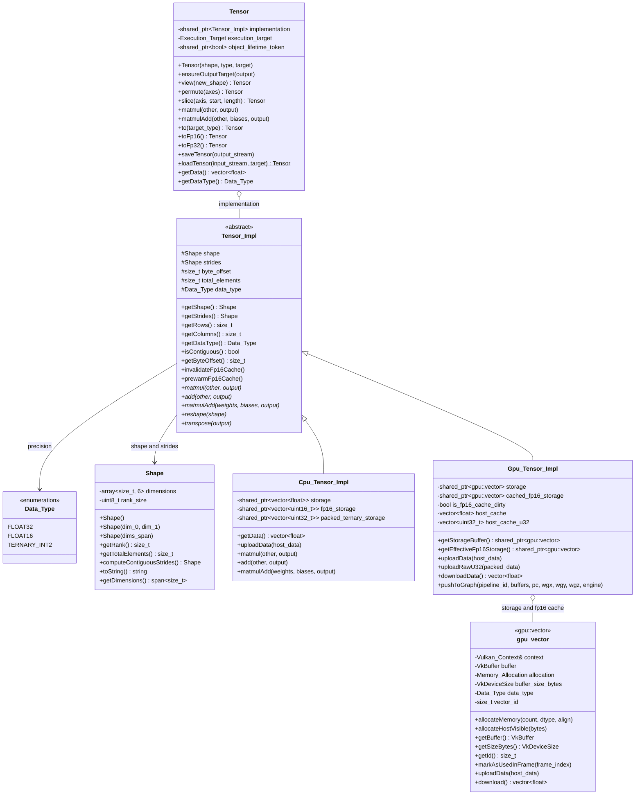
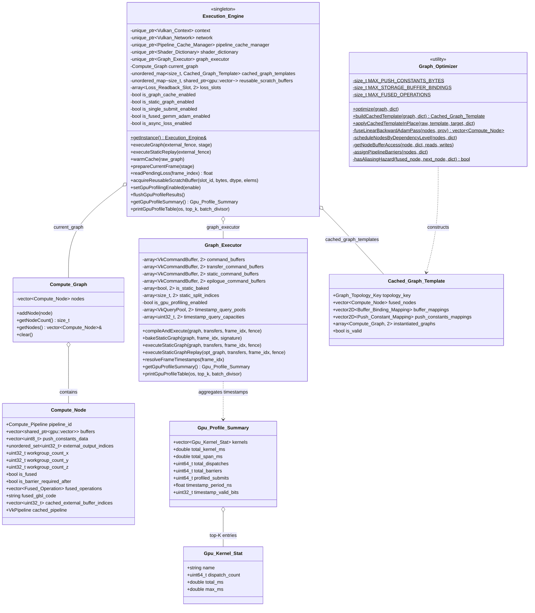
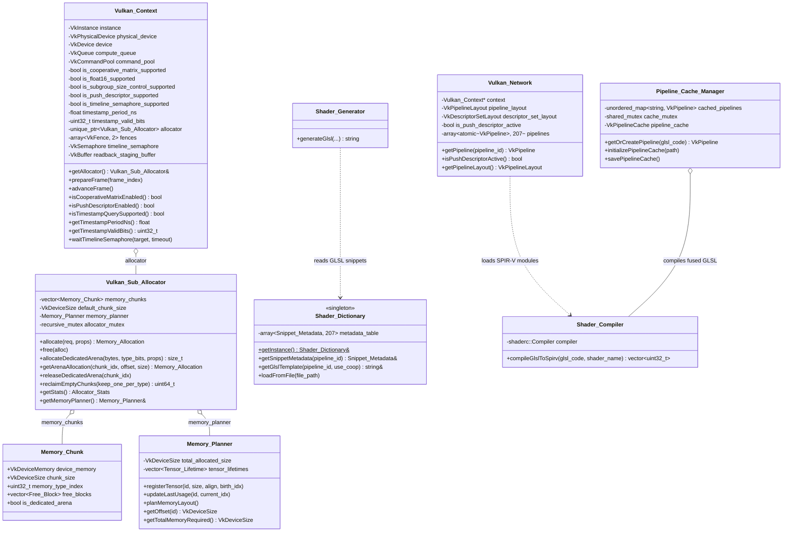
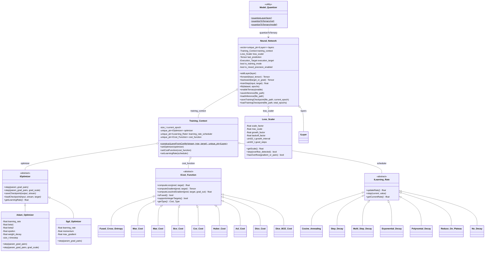
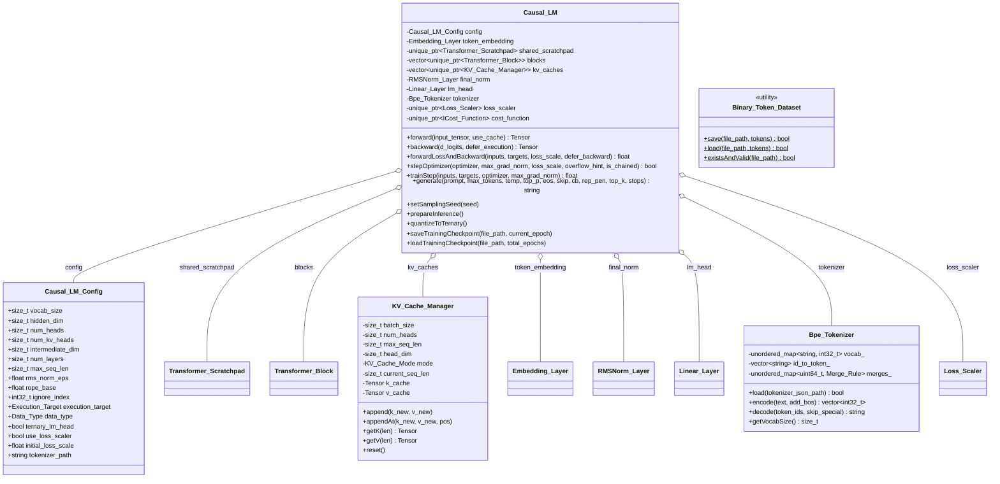
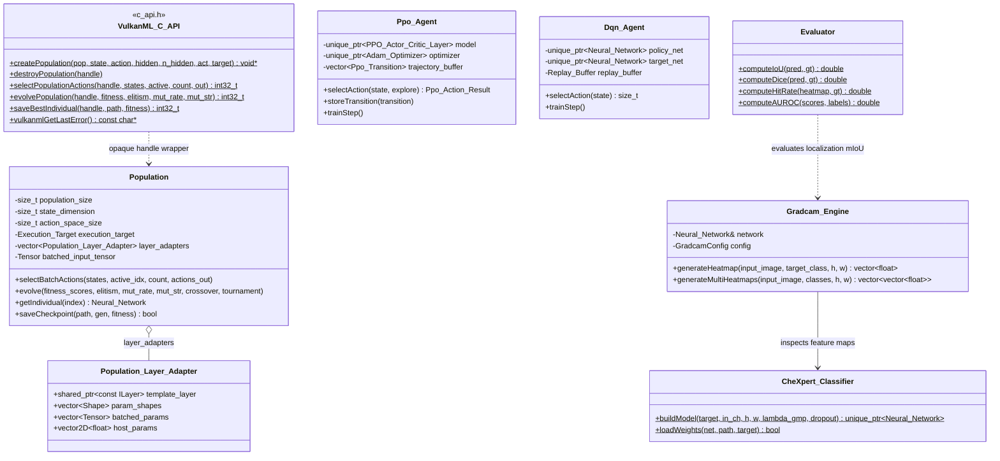
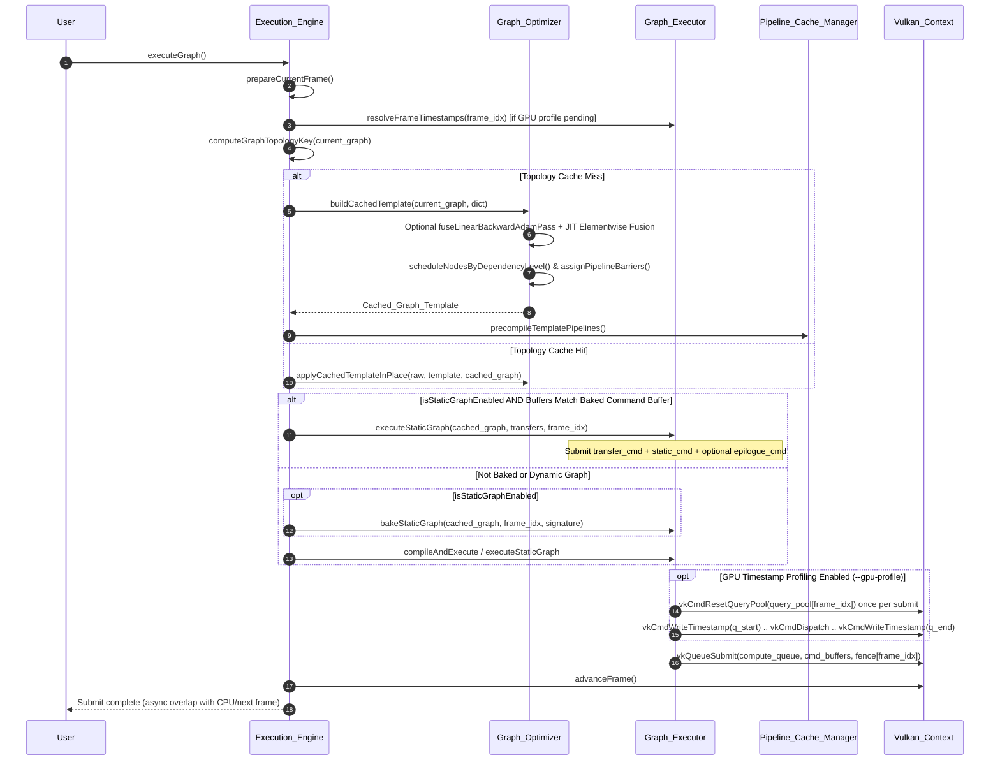
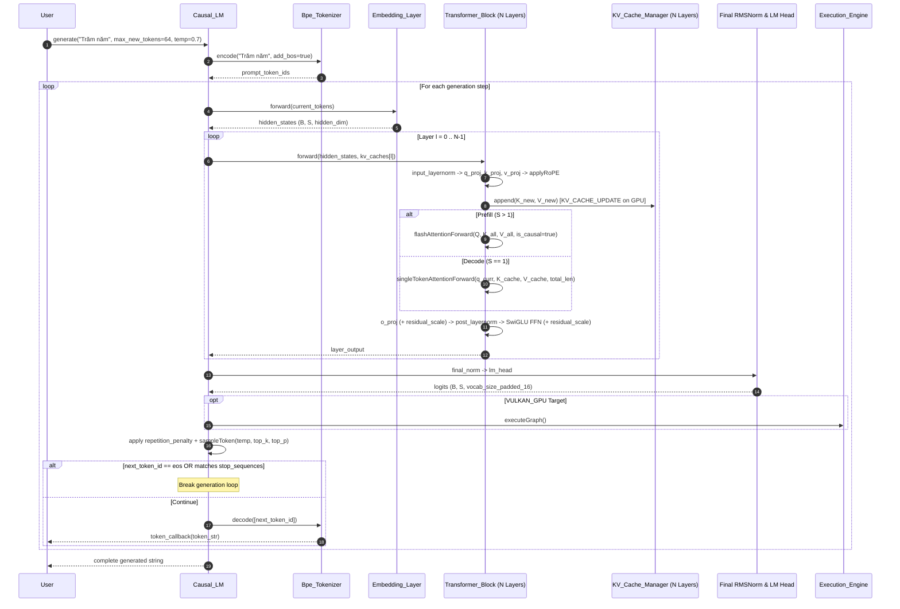

# VulkanML — Tài liệu Kiến trúc Hệ thống & Đặc tả Kỹ thuật Chi tiết

---

## 1. Tổng quan Hệ thống, Kiến trúc Build & Phân tầng (Architecture Layering)

VulkanML là một framework Deep Learning, Học tăng cường (Reinforcement Learning) và Mô hình Ngôn ngữ Lớn (LLM) hiệu năng cao được xây dựng từ đầu bằng ngôn ngữ **C++23**, sử dụng trực tiếp **Vulkan Compute API (SPIR-V)** làm backend tính toán GPU nguyên bản (native), không phụ thuộc vào CUDA hay ROCm. Hệ thống hỗ trợ đầy đủ cả chu trình **Huấn luyện (Training)**, **Suy luận (Inference)**, **Lượng tử hóa 1.58-bit Ternary (BitNet W1.58A16)**, **Thị giác Y tế (Vision/Segmentation)** và **Đo kiểm phần cứng GPU (Hardware Timestamp Profiling)** trên đa dạng phần cứng (AMD, NVIDIA, Intel, Apple Silicon qua MoltenVK).

Tính đến phiên bản hiện tại (11/2026), mã nguồn gồm **127 header files** trong `include/`, **103 source files** (`.cpp`) và **4 internal utility headers** trong `src/`, **141 GLSL `.comp` sources** (`compute_shader/comp/*.comp`, trong đó 66 shader hỗ trợ biến thể kép FP32/FP16 qua `-DUSE_FP16`, biên dịch tăng dần ra đầy đủ **207 `.spv` compute shaders** qua target CMake `compile_shaders`), thư mục ứng dụng mô-đun `apps/` (gồm `apps/chexpert/`), và 10 suite kiểm thử CTest trong `tests/`.

### 1.1. Kiến trúc Build & Đóng gói Mô-đun (`CMakeLists.txt`)

Cấu trúc [`CMakeLists.txt`](CMakeLists.txt) tách biệt lõi framework khỏi các phân hệ ứng dụng ngoài:
- **`vulkanml_core` (`SHARED` `.dll` tại `build/bin/`)**: Toàn bộ lõi C++23 (loại trừ `src/chexlocalize/`), liên kết `Vulkan::Vulkan` và `shaderc` dưới dạng **`PRIVATE`**, không làm rò rỉ `<vulkan/vulkan.h>` sang public header [`include/helper/vulkan_ml.h`](include/helper/vulkan_ml.h). Ký hiệu công khai được export qua `-Wl,--export-all-symbols` / `WINDOWS_EXPORT_ALL_SYMBOLS ON`, đi kèm **C ABI (`include/rl/c_api.h`)**.
- **`chexlocalize_ext` (`STATIC`)**: Module mở rộng ngoài lõi (`src/chexlocalize/*`) phục vụ phân loại X-quang ngực, Grad-CAM biên cạnh và phân vùng y tế.
- **Tích hợp MuJoCo tùy chọn**: Các target mô phỏng vật lý liên kết với `mujoco`, `glfw3` và OpenGL.
- **Xuất bản SDK (`vulkanml_sdk`)**: Hỗ trợ `cmake --install build --prefix ./vulkanml_sdk` đóng gói `bin/`, `lib/cmake/VulkanML/` (tệp `VulkanMLConfig.cmake` không phụ thuộc Vulkan SDK), public `include/` (loại trừ `chexlocalize`, `environment`, `ops`, internal `engine/` và `*_tensor_impl.h`, chỉ giữ 3 header thuần C++ `data_type.h`, `loss_scaler.h`, `async_data_pipeline.h`) cùng toàn bộ `compute_shader/`. Hệ thống kiểm thử `tests/` hỗ trợ chạy qua `ctest --test-dir build`.

### 1.2. Sơ đồ Phân tầng Kiến trúc (Layering Architecture Diagram)

```mermaid
graph TD
    subgraph L6["Layer 6 — Application, High-Level Models & Extensions"]
        NN["Neural_Network\n(Sequential Model, AMP Training & Checkpoints)"]
        POP["Population & C ABI\n(Neuroevolution, SoA Batched GPU GEMM, c_api.h)"]
        TC["Training_Context\n(Epoch State, Optimizer, Loss & Scheduler Management)"]
        LLM["Causal_LM\n(Decoder-only Transformer LLM, BitNet W1.58A16, Sampling)"]
        RL["RL Agents & Envs\n(Dqn_Agent, Ppo_Agent, Replay_Buffer, CartPole, MuJoCo)"]
        CHEX["CheXlocalize Extension\n(CheXpert_Classifier, Gradcam_Engine, Evaluator)"]
    end

    subgraph L5["Layer 5 — Tokenizers"]
        BPE["Bpe_Tokenizer\n(Byte-Pair Encoding, HuggingFace JSON Compatible)"]
    end

    subgraph L4["Layer 4 — Concrete Neural Layers"]
        LIN["Linear_Layer & Ternary_Linear_Layer\n(GEMM, CoopMat FP16 & BitNet W1.58A16)"]
        CONV["Conv2d_Layer\n(Im2Col / CoopMat GEMM Convolution)"]
        NORM["Normalization Layers\n(BatchNorm 1D/2D, InstanceNorm2D, RMSNorm_Layer)"]
        SWIGLU["SwiGLU_Layer & Embedding_Layer\n(Gated Activation & Token Lookup)"]
        TRB["Transformer_Block\n(Pre-RMSNorm, GQA, RoPE, FlashAttention, Shared Scratchpad)"]
        ACT["Activation & Dropout Layers\n(ReLU, LeakyReLU, GELU, Softmax, Sigmoid, Dropout)"]
        POOL["Pooling & Upsample Layers\n(MaxPool2D, AvgPool2D, GlobalAvgPool2D, UpSample2D)"]
        VIS["Vision Architectures\n(Res_Net_Block_2d, Res_Net_20, Multi_Scale_ResNet18, U_Net, NN_UNet)"]
        PPO_L["PPO_Actor_Critic_Layer\n(Shared Trunk, Actor Policy & Critic Value Heads)"]
    end

    subgraph L4i["Layer 4i — Loss Functions, Optimizers, Schedulers & Quantizer"]
        COST["ICost_Function\n(MSE, MAE, BCE, CCE, Huber, Fused_CCE, ASL, Dice, Dice_BCE)"]
        OPT["IOptimizer\n(Adam_Optimizer with AMP & Weight Decay, Sgd_Optimizer)"]
        LRS["ILearning_Rate\n(Cosine_Annealing, Step, MultiStep, Exp, Poly, Plateau, NoDecay)"]
        IL["ILayer\n(Abstract Base Class & Mixed-Precision Contract)"]
        MQ["Model_Quantizer\n(Ternary W1.58A16 Model Quantization Helpers)"]
    end

    subgraph L3["Layer 3 — Tensor & Math Abstraction System"]
        TENS["Tensor\n(Public PIMPL API, Strides, Zero-Copy Views & Serialization)"]
        SHP["Shape & Data_Type\n(Rank up to 6; FLOAT32, FLOAT16, TERNARY_INT2)"]
        CPU_IMPL["Cpu_Tensor_Impl\n(CPU Math & Multi-Precision Storage)"]
        GPU_IMPL["Gpu_Tensor_Impl\n(Vulkan Core Kernels, CoopMat, Lazy FP16 Cache)"]
        TIMPL["Tensor_Impl\n(Abstract Pure Interface)"]
    end

    subgraph OPS["Decoupled Operators — ops Namespace"]
        OPS_ACT["ops::activation & ops::dropout\n(relu, leakyRelu, gelu, softmax, sigmoid, dropout)"]
        OPS_OPT["ops::optimizer\n(adamStep, sgdStep with DynamicParams)"]
        OPS_LOSS["ops::loss\n(mse, mae, bce, cce, huber, asl, dice, diceBce, fusedCrossEntropy)"]
        OPS_VIS["ops::vision\n(conv2d, maxpool2d, avgpool2d, globalAvgPool2d, globalMaxPool2d, upsample2d)"]
        OPS_NORM["ops::normalization\n(batchNormForward, batchNorm2dForward, instanceNorm2dForward, rmsNormForward)"]
        OPS_LLM["ops::llm\n(flashAttention Forward/Backward, singleTokenAttention, applyRoPE, swiglu, embedding)"]
        OPS_LIN["ops::linear\n(linearForward, linearBackwardInput, linearBackwardWeightBias)"]
    end

    subgraph L2["Layer 2 — Graph Optimization, Static Execution & Telemetry"]
        EE["Execution_Engine\n(Singleton, Graph Cache, Static Replay, Single-Submit, Async Loss, Scratch Pool)"]
        GO["Graph_Optimizer\n(JIT Fusion, fuseLinearBackwardAdamPass, DAG Level Scheduling, Hazard Analysis)"]
        GX["Graph_Executor\n(Dynamic/Static Command Buffers, Push Descriptors, Transfer Barriers, VkQueryPool Profiler)"]
        CG["Compute_Graph\n(DAG Container of Compute_Node)"]
        LS["Loss_Scaler\n(Dynamic Mixed Precision FP16 AMP)"]
        ADP["Async_Data_Pipeline\n(Double-Buffered Background Host Prep)"]
    end

    subgraph L1["Layer 1 — Vulkan Core Compute Backend"]
        VK["Vulkan_Context\n(CoopMat 16x16x16, FP16, Subgroup Control, Push Desc, Timeline Semaphore, Timestamp Info)"]
        NET["Vulkan_Network\n(207 Lazy Atomic Compute Pipelines, Shared Cache)"]
        ALLOC["Vulkan_Sub_Allocator & Memory_Planner\n(Interval Coloring, Coalesced Blocks, Empty-Chunk Reclaim)"]
        GPUV["gpu::vector\n(RAII GPU SSBO Buffer & Frame Garbage Deferral)"]
        SHAD["Shader_Dictionary\n(207 Snippet Metadata & Fusion Capabilities)"]
        SHGEN["Shader_Generator\n(Dynamic GLSL Stitching for Operator Fusion)"]
        SHCOMP["Shader_Compiler\n(libshaderc GLSL to SPIR-V Compiler)"]
        PCM["Pipeline_Cache_Manager\n(Device-Keyed On-disk & Shared VkPipeline Cache)"]
    end

    subgraph L0["Layer 0 — Foundation Utilities & Profilers"]
        LOG["Logger & Resource_Path\n(Feature-Masked Logging & Layered Path Resolver)"]
        UPREFS["User_Preferences\n(JSON Device, Execution, Memory & Log Preferences)"]
        PROF["Runtime & Step_Timings\n(Zero-Vulkan DX Facade, Telemetry & Timers)"]
    end

    L6 --> L5
    L6 --> L4
    L6 --> L4i
    L4 --> L3
    L4i --> L3
    L4 --> OPS
    L3 --> L2
    OPS --> L2
    L2 --> L1
    L1 --> L0
```



### 1.3. Nguyên lý Phân tầng & Trách nhiệm (Layer Responsibilities)

Hệ thống tuân thủ nguyên tắc phân tầng nghiêm ngặt (Strict Layering):
1. **Layer 0 (Foundation Utilities & Profilers)**: Cung cấp `Logger` phân lọc theo `Log_Feature`, cấu hình JSON [`User_Preferences`](include/helper/user_preferences.h) (`user_preferences.json`), và [`Step_Timings`](include/helper/training_profiler.h) theo dõi thời gian CPU record, GPU submit, fence wait, đọc loss bất đồng bộ và số lượng dispatch node theo từng phase.
2. **Layer 1 (Vulkan Core Compute Backend)**: Đóng gói phần cứng Vulkan trong [`Vulkan_Context`](include/engine/vulkan_context.h) (Cooperative Matrix 16x16x16, Float16, Subgroup Size Control, Push Descriptors, Timeline Semaphore, Staging/Readback buffers và thông số Hardware Timestamp Period/ValidBits). Quản lý cấp phát VRAM khối lớn, Dedicated Arena và thu hồi chunk rỗng (`reclaimEmptyChunks` / `getStats`) qua [`Vulkan_Sub_Allocator`](include/engine/vulkan_sub_allocator.h), 207 compute pipeline qua [`Vulkan_Network`](include/engine/vulkan_network.h), kết hợp `Pipeline_Cache_Manager` khóa theo phần cứng GPU (`vendorID`, `deviceID`, `driverVersion`, `UUID`) dùng chung cho cả pipeline JIT và static.
3. **Layer 2 (Graph Optimization, Static Execution & GPU Telemetry)**: [`Execution_Engine`](include/engine/execution_engine.h), [`Graph_Optimizer`](include/engine/graph_optimizer.h) và [`Graph_Executor`](include/engine/graph_executor.h) hợp nhất toán tử JIT, phân tầng đồ thị DAG theo mức phụ thuộc (Dependency-Level Scheduling), bake và phát lại Command Buffer tĩnh (**Static Graph**), gom bước Forward+Loss+Backward+Optimizer vào một lần submit (**Single-Submit**), và cung cấp công cụ đo **Vulkan GPU Hardware Timestamp (`VkQueryPool`)** kích hoạt theo tùy chọn.
4. **Decoupled Operators (`ops::*`) & Layer 3 (Tensor System)**: Lớp [`Tensor`](include/math/tensor.h) dùng mẫu **PIMPL** kết hợp đa độ chính xác (`FLOAT32`, `FLOAT16`, `TERNARY_INT2`), tách hoàn toàn phần thuật toán ra các hàm thuần túy theo từng domain `ops::*`.
5. **Layer 4 & 4i (Neural Layers, Losses, Optimizers & Quantizer)**: Triển khai 26 loại tầng nơ-ron kế thừa [`ILayer`](include/layer/ilayer.h), 9 hàm mất mát (`ICost_Function`), 2 optimizer (`Adam_Optimizer` với Weight Decay/Dynamic Params, `Sgd_Optimizer` với Momentum), 7 bộ điều phối learning rate (`ILearning_Rate`), và [`Model_Quantizer`](include/helper/model_quantizer.h).
6. **Layer 5 (Tokenizers)**: Bao gồm `Bpe_Tokenizer` (Byte-Pair Encoding tương thích HuggingFace JSON) phục vụ tách token và giải mã văn bản cho huấn luyện và suy luận LLM.
7. **Layer 6 (Applications & Extensions)**: Gồm `Neural_Network`, [`Causal_LM`](include/llm/causal_lm.h), [`Population`](include/population.h) (+ C ABI), các tác tử RL (`Dqn_Agent`, [`Ppo_Agent`](include/rl/ppo_agent.h), `Cartpole_Env`, `MuJoCo_Humanoid_Env`) và extension y tế [`chexlocalize`](include/chexlocalize/chexpert_classifier.h).

---

## 2. Hệ thống Tensor & Bố cục Bộ nhớ (Tensor System & Memory Layout)

### 2.1. Sơ đồ Lớp — Tensor System (Class Diagram)



### 2.2. Cơ chế Thiết kế PIMPL, Zero-Copy View & Bảo toàn Static Graph

1. **Mẫu thiết kế PIMPL & Tuổi thọ Đích Bộ đệm (`ensureUniqueTensorTarget`)**:
   - Lớp [`Tensor`](include/math/tensor.h) giữ `std::shared_ptr<Tensor_Impl>` giúp sao chép nông $O(1)$ và tách biệt hoàn toàn header Vulkan/SIMD khỏi tầng người dùng.
   - Các toán tử `ops::*` quản lý bộ đệm đích thông qua [`ensureTensorTarget` và `ensureUniqueTensorTarget`](src/ops/ops_internal_utils.h#L42-L66):
     - `ensureUniqueTensorTarget` tái sử dụng buffer đích hiện có tại chỗ khi khớp `target`, `shape`, `dtype`, `contiguous` và không có alias bên ngoài (`impl.use_count() <= 2` tính cả biến cục bộ `impl` giữ 1 reference và `t.implementation` giữ 1 reference). Quy tắc này đảm bảo địa chỉ `VkBuffer` không bị cấp phát lại giữa các step, giúp **Static Command Buffer Graph** đạt **100% cache hit**.

2. **Cấu trúc `Shape`, `Strides` & Zero-Copy Views**:
   - `Shape` sử dụng mảng tĩnh `std::array<size_t, 6>` (hỗ trợ tối đa rank 6) và `uint8_t rank_size`, tránh hoàn toàn cấp phát Heap.
   - Bố cục **Row-Major**:
     $$S_{k-1} = 1, \quad S_i = S_{i+1} \times d_{i+1}, \quad \text{Linear\_Index} = \text{byte\_offset} + \sum_{j=0}^{k-1} i_j S_j$$
   - Các thao tác `view()`, `slice()`, `permute()` chia sẻ cùng `storage` nếu hợp lệ về tính liên tục (**Zero-Copy View**). Khi tensor không liên tục cần đưa vào kernel tuyến tính, `contiguous()` sinh node `CONTIGUOUS` / `CONTIGUOUS_FP16` dồn dữ liệu về vùng nhớ phẳng.

3. **Đa Độ chính xác: `FLOAT32`, `FLOAT16` & `TERNARY_INT2` ([`data_type.h`](include/engine/data_type.h))**:
   - **`FLOAT32` / `FLOAT16`**: Trong chế độ FP16/CoopMat, `Gpu_Tensor_Impl` có thể lưu trực tiếp dữ liệu FP16 hoặc tự động chuyển đổi lười (`cached_fp16_storage`) với cờ `is_fp16_cache_dirty` đồng bộ qua `invalidateFp16Cache()` sau mỗi lần cập nhật trọng số.
   - **`TERNARY_INT2` (BitNet W1.58A16)**: Phục vụ lượng tử hóa trọng số 3 giá trị $\{-1, 0, +1\}$. Khi đóng gói phục vụ suy luận (`QUANTIZE_PACK_TERNARY`), 16 phần tử ternary liên tiếp được nén chặt vào **1 từ `uint32_t`** (2 bit/trọng số) đi kèm 1 hệ số tỉ lệ **absmean $\gamma = \frac{1}{N}\sum |W_i|$**, giúp giảm **16x** dung lượng bộ nhớ so với FP32 và **8x** so với FP16.

---

## 3. Hệ thống Lớp Nơ-ron (Concrete Neural Layers)

### 3.1. Sơ đồ Lớp — Layer System (Class Diagram)

```mermaid
classDiagram
    class ILayer {
        <<abstract>>
        #bool is_accumulated
        #bool is_mixed_precision_enabled
        +forward(input_tensor)* Tensor
        +backward(output_gradient)* Tensor
        +forward(batched_input, batched_params) Tensor
        +clone()* unique_ptr~ILayer~
        +getParametersAndGradients() vector~pair~
        +getNoDecayParameters() vector~const Tensor*~
        +hasParameters() bool
        +supportsPopulationBatch() bool
        +supportsStaticGraph() bool
        +setMixedPrecision(enable)
        +setAccumulated(is_accumulated)
        +invalidateWeightCache()
        +prepareInference()
        +quantizeToTernary()
        +dequantizeFromTernary()
        +isTernary() bool
        +snapshotNonTrainableState(out)
        +restoreNonTrainableState(in, cursor)
    }

    class Linear_Layer {
        -Tensor weights
        -Tensor biases
        -Data_Type data_type
        -Tensor master_weights
        -Tensor effective_weights
        -Tensor packed_weights
        -Tensor gamma_tensor
        -bool has_packed_inference
        +forward(input_tensor) Tensor
        +backward(output_gradient) Tensor
        +prepareInference()
        +quantizeToTernary()
        +dequantizeFromTernary()
    }

    class Ternary_Linear_Layer {
        +Ternary_Linear_Layer(in_dim, out_dim, target, gain)
    }

    class Transformer_Scratchpad {
        +Tensor fwd_scaled
        +Tensor dy_branch
        +Tensor dg
        +Tensor du
        +Tensor dq
        +Tensor dk
        +Tensor dv
        +array~Tensor, 2~ dx_slots
        +setExecutionTarget(target)
    }

    class Transformer_Block {
        -size_t hidden_dim
        -size_t num_heads
        -size_t head_dim
        -size_t num_kv_heads
        -float residual_scale
        -RMSNorm_Layer input_layernorm
        -Linear_Layer q_proj
        -Linear_Layer k_proj
        -Linear_Layer v_proj
        -Linear_Layer o_proj
        -RMSNorm_Layer post_attention_layernorm
        -Linear_Layer gate_proj
        -Linear_Layer up_proj
        -Linear_Layer down_proj
        -Transformer_Scratchpad* shared_scratchpad
        -size_t scratch_dx_slot
        +forward(input_tensor) Tensor
        +forward(x, kv_cache) Tensor
        +backward(output_gradient) Tensor
        +setSharedScratchpad(pad, dx_slot)
        +prepareInference()
        +quantizeToTernary()
    }

    class Conv2d_Layer {
        -Tensor weights
        -Tensor biases
        -uint32_t kernel_size
        -uint32_t stride
        -uint32_t padding
        +forward(input_tensor) Tensor
        +backward(output_gradient) Tensor
    }

    class U_Net_Layer {
        -vector~unique_ptr~ILayer~~ enc1_to_3
        -vector~unique_ptr~ILayer~~ bottleneck_layers
        -vector~unique_ptr~ILayer~~ dec3_to_1
        -unique_ptr~Conv2d_Layer~ final_conv
        -unique_ptr~Sigmoid_Layer~ final_sigmoid
    }

    class NN_UNet_Layer {
        -vector~unique_ptr~ILayer~~ enc1_to_4
        -vector~unique_ptr~ILayer~~ bottleneck_layers
        -vector~unique_ptr~ILayer~~ dec4_to_1
        -bool enable_deep_supervision
        -unique_ptr~Conv2d_Layer~ ds3_conv
        -unique_ptr~Conv2d_Layer~ ds2_conv
    }

    class Multi_Scale_ResNet18_Balanced_Layer {
        -unique_ptr~Conv2d_Layer~ stem_conv
        -unique_ptr~Res_Net_Block_2d_Layer~ stage1_to_4
        -unique_ptr~Global_Avg_Pool_2d_Layer~ gap2_to_4
    }

    class Instance_Norm_2d_Layer {
        -Tensor gamma
        -Tensor beta
        -float epsilon
    }

    ILayer <|-- Linear_Layer
    Linear_Layer <|-- Ternary_Linear_Layer
    ILayer <|-- Conv2d_Layer
    ILayer <|-- Transformer_Block
    ILayer <|-- U_Net_Layer
    ILayer <|-- NN_UNet_Layer
    ILayer <|-- Multi_Scale_ResNet18_Balanced_Layer
    ILayer <|-- Instance_Norm_2d_Layer
    ILayer <|-- RMSNorm_Layer
    ILayer <|-- SwiGLU_Layer
    ILayer <|-- Embedding_Layer
    ILayer <|-- Batch_Norm_Layer
    ILayer <|-- Batch_Norm_2d_Layer
    ILayer <|-- Res_Net_Block_2d_Layer
    ILayer <|-- Res_Net_20_Layer
    ILayer <|-- PPO_Actor_Critic_Layer
    ILayer <|-- Dropout_Layer
    Transformer_Block o-- RMSNorm_Layer : input and post norm
    Transformer_Block o-- Linear_Layer : qkv o gate up down
    Transformer_Block --> Transformer_Scratchpad : borrows shared scratchpad
```



### 3.2. Phân nhóm 26 Lớp Nơ-ron & Các Hợp đồng Lớp

`enum class Layer_Type` ([`ilayer.h`](include/layer/ilayer.h#L26-L55)) định nghĩa **26 loại lớp**, chia thành 5 nhóm:
- **Linear, Embedding & Ternary**: `Linear_Layer` (hợp nhất FP32, FP16 và BitNet 1.58-bit W1.58A16), `Ternary_Linear_Layer`, `Embedding_Layer`.
- **Chuẩn hóa & Kích hoạt**: `RMSNorm_Layer`, `Batch_Norm_Layer`, `Batch_Norm_2d_Layer`, `Instance_Norm_2d_Layer`, `Relu_Layer`, `Leaky_Relu_Layer`, `Gelu_Layer`, `Softmax_Layer`, `Sigmoid_Layer`, `Dropout_Layer`, `SwiGLU_Layer`.
- **Thị giác (Vision & Segmentation)**: `Conv2d_Layer`, `Max_Pool_2d_Layer`, `Avg_Pool_2d_Layer`, `Global_Avg_Pool_2d_Layer`, `Up_Sample_2d_Layer`, `Res_Net_Block_2d_Layer`, `Res_Net_20_Layer`, `Multi_Scale_ResNet18_Balanced_Layer`, `U_Net_Layer`, `NN_UNet_Layer` (hỗ trợ 4 tầng encoder/decoder kèm nhánh Deep Supervision `ds2`, `ds3`).
- **Kiến trúc Transformer & RL**: `Transformer_Block` (Pre-RMSNorm + GQA + RoPE + FlashAttention + SwiGLU FFN qua `ops::llm::swigluForward/Backward`), `PPO_Actor_Critic_Layer`.

**Các cơ chế vận hành cốt lõi của `ILayer`**:
1. **Tích lũy Gradient (`is_accumulated`) & Weight Decay**: Khi `is_accumulated = true`, lớp cộng dồn $\nabla W \mathrel{+}= \nabla W_{step}$. Các tham số bias và hệ số $\gamma$ chuẩn hóa được loại trừ khỏi weight decay thông qua `getNoDecayParameters()`.
2. **Quản lý Trạng thái BitNet W1.58A16 ([`Linear_Layer`](include/layer/linear_layer.h#L44-L55))**: Khi huấn luyện QAT (`TERNARY_INT2`), `master_weights` FP32 giữ trọng số liên tục còn `effective_weights` chứa bản lượng tử hóa giả lập (Fake-Quantized) cho Forward/Backward; khi gọi `prepareInference()` / `quantizeToTernary()`, trọng số được nén vào `packed_weights` (2-bit/trọng số) cùng `gamma_tensor` để thực thi kernel `MATMUL_TERNARY_FP16`.
3. **Chia sẻ Scratchpad giữa các tầng (`Transformer_Scratchpad`)**: Trong mô hình `Causal_LM` nhiều tầng, toàn bộ các [`Transformer_Block`](include/layer/transformer_block.h#L20-L82) dùng chung 1 `Transformer_Scratchpad` với cặp bộ đệm luân phiên **`dx_slots[2]`** (`scratch_dx_slot = layer_idx & 1u`), cho phép tầng $L$ nhận gradient từ `dx_slots[(L+1)&1]` và ghi `dx` vào `dx_slots[L&1]` mà không ghi đè dữ liệu đang đọc.

---

## 4. Hệ thống Toán tử Độc lập (Decoupled Operator Subsystem — `ops::*`)

Việc tách toàn bộ toán tử toán học khỏi `Tensor_Impl` vào 8 namespace độc lập `ops::*` cho phép tái sử dụng trực tiếp giữa các layer, hỗ trợ truyền tường minh `Execution_Engine*`, và đảm bảo mỗi node đẩy vào `Compute_Graph` mang đầy đủ metadata cho `Graph_Optimizer`.

### 4.1. Bảng Đặc tả Toán tử Hệ thống (Operator Specifications)

| Namespace | Nhóm Toán tử chính | Công thức / Chức năng cốt lõi | Cài đặt GPU / Vulkan nổi bật |
| :--- | :--- | :--- | :--- |
| `ops::activation` | `relu`, `leakyRelu`, `gelu`, `softmax`, `sigmoid` (+ Backward) | Kích hoạt phi tuyến và đạo hàm chuỗi | Elementwise FP32/FP16 & CoopMat variants; Shared-memory Reduction cho Softmax |
| `ops::dropout` | `dropout`, `dropoutBackward` | $Y = X \odot \frac{M}{1-p}$ (train), $Y = X$ (eval) | `DROPOUT_FORWARD` / `DROPOUT_FORWARD_FP16` |
| `ops::linear` | `linearForward`, `linearBackwardInput`, `linearBackwardWeightBias` (+ CoopMat/Ternary) | $Y = XW^T + B$, $dX = dY \cdot W$, $dW = X^T dY$ | Cooperative Matrix 16x16x16 Subgroup; ColumnMajor direct load; `MATMUL_TERNARY_FP16` |
| `ops::loss` | `mse`, `mae`, `bce`, `cce`, `huber`, `asl`, `dice`, `diceBce`, `fusedCrossEntropy` | Hàm mất mát hồi quy, phân loại đa nhãn mất cân bằng (ASL), phân vùng (Dice/Dice+BCE), và Fused Softmax+CCE | Reduction 2 pha (`SUM_REDUCE_FINAL`, `DICE_REDUCE_FINAL`); `FUSED_CROSS_ENTROPY_FP16` + `COUNT_VALID_TARGETS` |
| `ops::vision` | `conv2d`, `maxpool2d`, `avgpool2d`, `globalAvgPool2d`, `globalMaxPool2d`, `upsample2d` (+ Backward) | Tích chập 2D (Im2Col/CoopMat GEMM), gộp đặc trưng và nội suy phục hồi độ phân giải | Tái sử dụng Scratch Buffer Im2Col từ `Execution_Engine`; `CONV2D_WEIGHT_GRADIENT_COOPMAT_FP16` |
| `ops::normalization` | `rmsNormForward/Backward`, `batchNormForward/Backward`, `batchNorm2dForward/Backward`, `instanceNorm2dForward/Backward` | Chuẩn hóa trên vector đặc trưng / theo batch / từng instance không gian $H \times W$ | `RMSNORM_FP16`, `RMSNORM_BACKWARD_FP16`, `RMSNORM_GAMMA_GRAD_FP16`, `INSTANCE_NORM2D_*` |
| `ops::optimizer` | `adamStep`, `sgdStep` | AdamW (tích hợp Weight Decay, Gradient Clipping, AMP `inv_scale`) & SGD Momentum | `ADAM_UPDATE_FP16`, `SGD_MOMENTUM_UPDATE_FP16`, `LINEAR_BACKWARD_WEIGHT_ADAM_COOPMAT_FP16` |
| `ops::llm` | `flashAttentionForward`, `flashAttentionBackward`, `singleTokenAttentionForward`, `applyRoPE`, `swigluForward/Backward`, `fusedSwiGLUForward/Backward`, `embeddingForward/Backward` | Chú ý theo khối (Tri Dao) hỗ trợ Causal & GQA; xoay vị trí RoPE; SwiGLU; cập nhật KV Cache qua `KV_CACHE_UPDATE` | `FLASH_ATTENTION_FP16`, `FLASH_ATTENTION_BACKWARD_DQ_FP16`, `FLASH_ATTENTION_BACKWARD_DKV_FP16`, `FLASH_ATTENTION_LSE_FP16`, `ATTENTION_DECODE_FP16`, `KV_CACHE_UPDATE_FP16` |

### 4.2. Các Tối ưu hóa Mức Shader & Toán tử Trọng tâm

1. **Toán tử Mất mát Hợp nhất & Đọc Loss Bất đồng bộ (`ops::loss::fusedCrossEntropy`)**:
   - Kernel `FUSED_CROSS_ENTROPY_FP16` tính Log-Sum-Exp trực tiếp trên thanh ghi:
     $$m = \max_j Z_j, \quad l = \sum_j e^{Z_j - m}, \quad \frac{\partial L}{\partial Z_i} = P_i - \mathbb{I}(i = \text{target})$$
   - Khi cấu hình `Cross_Entropy_Config` bật `readback_loss = true` kết hợp `defer_execution = true` và `is_async_loss_enabled`, hàm ghi tổng loss cùng `COUNT_VALID_TARGETS` vào `Loss_Readback_Slot` của frame hiện tại thay vì gọi `vkDeviceWaitIdle` ngay lập tức, cho phép gộp chung lệnh tính Forward+Loss với Backward+Optimizer vào 1 lần submit.

2. **Nạp Tham số Động cho Optimizer (`Adam_Dynamic_Params` trong `Graph_Executor`)**:
   - Trong `Static Command Buffer Graph`, toàn bộ push constants của các node tĩnh đã được ghi cứng vào command buffer. Tuy nhiên các siêu tham số optimizer như `learning_rate`, hệ số hiệu chỉnh bias `inv_bc1`, `inv_sqrt_bc2` và `inv_scale` thay đổi liên tục qua từng batch.
   - `Graph_Executor` duy trì bộ đệm Host-Visible theo từng frame (`dynamic_optimizer_buffers[2]` và pool `dynamic_optimizer_param_pool[2]` tại binding tham số động `binding = 4` cho AdamW / `binding = 5` cho Linear+AdamW). Mỗi bước chỉ cần ghi đè vùng Host-Visible này trước khi phát lại Command Buffer tĩnh mà **không cần ghi lại hay tái biên dịch command buffer**.

3. **Tối ưu hóa Load `ColumnMajor` Trực tiếp trong Linear Backward CoopMat**:
   - Các shader `linear_backward_input_coopmat_fp16.comp`, `linear_backward_weight_bias_coopmat_fp16.comp` và `linear_backward_weight_adam_coopmat_fp16.comp` thay thế vòng lặp chuyển vị ma trận thủ công qua Shared Memory ($W^T, X^T$ gây xung đột bank và truy cập uncoalesced) bằng lời gọi phần cứng trực tiếp:
     `coopMatLoad(..., ..., ..., gl_CooperativeMatrixLayoutColumnMajor)`, giúp khai thác tối đa băng thông phần cứng của lệnh ma trận con 16x16x16.

4. **Tương thích Đường ống Tensor 16x16x16**:
   - Trên AMD Radeon 860M, `vocab_size` được căn chỉnh lên bội số của 16 (`((raw_vocab_size + 15) / 16) * 16`, ví dụ `4277 -> 4288` trong `train_sllm.cpp`) để `MATMUL_ADD_COOPMAT_FP16` và các kernel `LINEAR_BACKWARD_*_COOPMAT_FP16` ở `lm_head` luôn chạy được đường nhanh Cooperative Matrix thay vì rơi về fallback shader thông thường.

---

## 5. Đồ thị Tính toán, Tối ưu hóa JIT, Static Graph & GPU Timestamp Profiling

### 5.1. Sơ đồ Lớp — Engine, Optimizer & Executor (Class Diagram)



### 5.2. Cơ chế Tối ưu hóa Đồ thị, Đồng bộ hóa & Telemetry Phần cứng

1. **JIT Operator Fusion, `Graph_Topology_Key` & Tùy chọn `fuseLinearBackwardAdamPass`**:
   - Hai node kế tiếp hợp nhất được khi Consumer thuộc lớp `Operation_Class::ELEMENTWISE`, không sử dụng Cooperative Matrix, tương thích số lượng workgroup/luồng, không có xung đột bộ nhớ RAW/WAR (`hasAliasingHazard`), và không vượt giới hạn phần cứng (`MAX_STORAGE_BUFFER_BINDINGS = 32`, `MAX_PUSH_CONSTANTS_BYTES = 128`, `MAX_FUSED_OPERATIONS = 8`).
   - Khi bật `--fused-gemm-adam`, `Graph_Optimizer::fuseLinearBackwardAdamPass` có thể gộp phép nhân gradient trọng số (`LINEAR_BACKWARD_WEIGHT_BIAS_*`) với bước cập nhật AdamW (`ADAM_UPDATE_*`) thành node `LINEAR_BACKWARD_WEIGHT_ADAM_COOPMAT_FP16`.
   - Khóa tra cứu [`Graph_Topology_Key`](include/engine/graph_optimizer.h#L80-L87) kiểm chứng toàn vẹn cấu trúc (`is_coop_enabled`, `is_fused_gemm_adam`, chuỗi `pipeline_id`, workgroup grid, kích thước/word cấu trúc của push constants, và kiểu dữ liệu buffer) trước khi áp dụng template qua `applyCachedTemplateInPlace`.

2. **Phân tầng Thực thi DAG (`scheduleNodesByDependencyLevel`) & Hazard-Aware Barriers**:
   - [`Graph_Optimizer::scheduleNodesByDependencyLevel`](include/engine/graph_optimizer.h#L187-L194) sắp xếp lại các node độc lập về dữ liệu thành các **mức phụ thuộc (Dependency Levels)** dựa trên tập Đọc/Ghi (`getNodeBufferAccess`) và sau đó gọi `assignPipelineBarriers` để chỉ chèn `vkCmdPipelineBarrier` tại ranh giới thực sự có xung đột RAW, WAR hoặc WAW.
   - Ví dụ tiêu biểu: hai node độc lập cùng đọc chung `Q, K, V, O, dO, LSE` là `FLASH_ATTENTION_BACKWARD_DQ_FP16` (chỉ ghi index 5: `dQ`) và `FLASH_ATTENTION_BACKWARD_DKV_FP16` (chỉ ghi index 6, 7: `dK, dV`) được xếp vào cùng 1 level thực thi song song mà không cần barrier ngăn giữa chúng.
   - Tương tự, `Graph_Executor::recordTransferTasks` chỉ chèn `inter_transfer_barrier` giữa các tác vụ DMA `vkCmdCopyBuffer` / `vkCmdFillBuffer` khi có vùng nhớ giao nhau thực sự thay vì chèn mù sau mỗi lệnh.

3. **Static Command Buffer Graph & Chế độ Single-Submit (`FWD+LOSS+BWD+OPT`)**:
   - **Static Graph**: `Graph_Executor::bakeStaticGraph` ghi sẵn toàn bộ các node không đổi cấu trúc vào `static_command_buffers[frame_index]`. Ở các step tiếp theo, nếu `isStaticGraphBuffersMatching` hợp lệ, `executeStaticGraph` / `executeStaticGraphReplay` gửi lại command buffer tĩnh kèm một `epilogue_command_buffers[frame_index]` nhỏ (nếu có node động hoặc cập nhật tham số động), triệt tiêu gần như toàn bộ chi phí CPU record.
   - **Single-Submit Step** (bật mặc định, tắt bằng `--no-single-submit`): Thay vì tách step huấn luyện làm 2 lần submit (`FWD+LOSS` sync lấy scalar loss -> `BWD+OPT`), [`Causal_LM`](include/llm/causal_lm.h#L169-L177) dùng cờ `defer_backward_execution = true` để **toàn bộ đồ thị Forward + Loss + Backward + Optimizer chạy trong 1 `vkQueueSubmit` duy nhất** (~388 dispatches/step trên cấu hình mặc định). Kết quả loss của frame trước được thu hồi bất đồng bộ sau khi fence hoàn tất thông qua `Loss_Readback_Slot` (có cờ `is_submitted` bảo vệ tránh đọc nhầm trước khi lệnh được gửi).

4. **Vulkan GPU Hardware Timestamp Query Profiling (`--gpu-profile`)**:
   - Thiết kế hoàn toàn **opt-in** (tắt mặc định để chi phí bằng 0 trong quá trình train thường). Khi kích hoạt:
     - [`Vulkan_Context`](include/engine/vulkan_context.h#L247-L249) cung cấp `limits.timestampPeriod` (`10.0 ns` trên AMD Radeon 860M) và `timestampValidBits` (`64-bit`).
     - [`Graph_Executor`](include/engine/graph_executor.h#L99-L125) cấp phát `VkQueryPool` (`VK_QUERY_TYPE_TIMESTAMP`, dung lượng khởi tạo `4096` queries/frame) theo từng frame in-flight.
     - Trong `recordComputeNodes`, mỗi dispatch được kẹp giữa hai lệnh `vkCmdWriteTimestamp(..., VK_PIPELINE_STAGE_COMPUTE_SHADER_BIT)`. Ở chế độ Static Replay, `vkCmdResetQueryPool` được ghi đúng một lần ở đầu `static_command_buffers[f]` (chỉ ghi ở `epilogue_command_buffers[f]` nếu không có static buffer chạy cùng submit).
     - Khi fence khung hình hoàn tất (`resetFrameState` hoặc `flushGpuProfileResults`), `resolveFrameTimestamps` đọc `vkGetQueryPoolResults` với mặt nạ bit `timestampValidBits`, tổng hợp [`Gpu_Profile_Summary`](include/engine/graph_executor.h#L49-L59) theo từng pipeline (bao gồm cả chuỗi `FUSED(...)`), tổng thời gian active GPU, độ lệch barrier (`Gap`), và tổng số compute barrier phát sinh.

---

## 6. Tầng Lõi Vulkan Compute Backend & Bộ cấp phát con (Vulkan Core Backend & Sub-Allocator)

### 6.1. Sơ đồ Lớp — Vulkan Core Backend (Class Diagram)



### 6.2. Quản lý Bộ nhớ Sub-Allocation, Push Descriptors & Double Buffering

1. **Quản lý VRAM qua `Vulkan_Sub_Allocator`**:
   - Cấp phát các `Memory_Chunk` kích thước tiêu chuẩn `64 MB` trên vùng `VK_MEMORY_PROPERTY_DEVICE_LOCAL_BIT` nhằm tránh vượt giới hạn `maxMemoryAllocationCount` của driver Vulkan (thường `4096`).
   - Sử dụng chiến lược **Best-Fit Alignment** kết hợp **Coalescing** (`insertAndCoalesce`) các block trống liền kề khi giải phóng bộ đệm để chống phân mảnh.
   - Hỗ trợ **Dedicated Arena API** (`allocateDedicatedArena` / `getArenaAllocation` / `releaseDedicatedArena`) và **Thu hồi Chunk rỗng** (`reclaimEmptyChunks` + thống kê `getStats`, đồng thời giải phóng ngay chunk quá khổ hoặc dư thừa trong `free()`), tránh giữ VRAM chết sau giai đoạn peak.

2. **Hoạch định Bộ nhớ Tĩnh Chính xác Theo Khoảng Sống (`Memory_Planner`)**:
   - [`Memory_Planner::planMemoryLayout`](include/engine/vulkan_sub_allocator.h#L50-L91) sử dụng danh sách khoảng sống đã chiếm `Virtual_Block::occupied_intervals` để thực hiện thuật toán **Interval-Overlap Coloring** chuẩn xác, đảm bảo ngay cả khi danh sách tensor đầu vào không sắp xếp theo `start_node_index`, hai tensor có khoảng sống giao nhau tuyệt đối không bị gán đè offset, đồng thời tái sử dụng 100% offset cho các tensor có vòng đời tách rời.

3. **Push Descriptors (`VK_KHR_push_descriptor`) vs Persistent Descriptor Cache**:
   - Trên phần cứng hỗ trợ `VK_KHR_push_descriptor` (như AMD Radeon 860M), [`Graph_Executor::pushDescriptors`](include/engine/graph_executor.h#L173-L176) ghi trực tiếp binding vào luồng lệnh command buffer qua `vkCmdPushDescriptorSetKHR`, loại bỏ chi phí cấp phát và cập nhật `VkDescriptorSet` từ pool. Với phần cứng không hỗ trợ, hệ thống tự động rơi về `persistent_descriptor_caches[2]`.

4. **Double-Buffered Frames in Flight (`MAX_FRAMES_IN_FLIGHT = 2`) & Trì hoãn Thu hồi Rác**:
   - Hệ thống duy trì 2 khung hình luân phiên (`frame 0` và `frame 1`), đồng bộ bằng `fences[2]` và hỗ trợ `timeline_semaphore` + buffer Staging/Readback ánh xạ liên tục (`readback_staging_buffer`). Các buffer bị hủy chỉ được đưa vào `garbage_bins[used_frame]` và chỉ giải phóng thực sự tại `cleanGarbage(frame_index)` sau khi `vkWaitForFences` xác nhận GPU đã dùng xong khung hình đó.

---

## 7. Mô hình Huấn luyện, Hàm Mất mát, Optimizer & Lượng tử hóa BitNet

### 7.1. Sơ đồ Lớp — Training Subsystem (Class Diagram)



### 7.2. Chu trình Huấn luyện Hỗn hợp (AMP), Tối ưu hóa & Lượng tử hóa BitNet 1.58-bit

1. **Dynamic Mixed Precision (`Loss_Scaler`)**:
   - Gradient được phóng đại theo `scale_factor` trước khi chạy Backward trên `FLOAT16` nhằm tránh mất độ chính xác do Underflow.
   - Nếu xuất hiện `NaN`/`Inf` (hoặc overflow), step cập nhật bị bỏ qua và `scale_factor *= backoff_factor` (mặc định `0.5`). Nếu ổn định liên tiếp `growth_interval` bước, `scale_factor *= growth_factor` (`2.0`).

2. **Đa dạng Hàm Mất mát cho Vision, Segmentation & LLM (`Cost_Type`)**:
   - Bên cạnh các hàm chuẩn (`MSE`, `MAE`, `BCE`, `CCE`, `Huber`, `Fused_Cross_Entropy`), thư viện bổ sung đầy đủ bộ hàm cho bài toán y tế và mất cân bằng lớp: **Asymmetric Loss (`Asl_Cost`)**, **Soft Dice Loss (`Dice_Cost`)** và **Dice + BCE Loss (`Dice_BCE_Cost`)** chạy tăng tốc bằng GPU reduction shader (`dice_reduce_final.comp`, `dice_bce_reduce_final.comp`).

3. **Lượng tử hóa 1.58-bit (`Model_Quantizer` & `TERNARY_INT2`)**:
   - Quá trình huấn luyện nhận thức lượng tử hóa (**QAT**) dùng kernel `REDUCE_ABSMEAN_PASS1/2` để tính $\gamma = \text{mean}(|W|)$ và `FAKEQUANT_TERNARY` kẹp trọng số vào $\{-1, 0, +1\} \cdot \gamma$ trong Forward trong khi cập nhật gradient trên `master_weights` FP32 theo Straight-Through Estimator (STE).
   - Khi chuyển sang triển khai qua [`Model_Quantizer::quantizeToTernary`](include/helper/model_quantizer.h#L15-L25), `QUANTIZE_PACK_TERNARY` nén trọng số xuống 2-bit/trọng số (`TERNARY_INT2`), hỗ trợ lưu/nạp định dạng `.bin` / `.nnck` nhỏ gọn qua các magic header `TERN`, `TER2`, `TERC`.

---

## 8. Phân hệ Mô hình Ngôn ngữ Lớn (`Causal_LM`) & Tokenizer

### 8.1. Sơ đồ Lớp — LLM Subsystem (Class Diagram)



### 8.2. Kiến trúc LLM, Luồng Huấn luyện CLI (`train_sllm`) & Suy luận KV Cache

1. **Decoder-Only Transformer hỗ trợ GQA & Chia sẻ Scratchpad**:
   - [`Causal_LM`](include/llm/causal_lm.h) kết hợp Pre-RMSNorm, RoPE, **Grouped-Query Attention (GQA)** qua trường `num_kv_heads` (khi `0` mặc định bằng `num_heads`), FlashAttention theo khối Tile, SwiGLU FFN và **Scaled Residual Connections** (`residual_scale`).
   - Tất cả các block chia sẻ chung một `Transformer_Scratchpad`, kết hợp cùng `Static Command Buffer Graph` và `Single-Submit` giúp huấn luyện toàn bộ mạng LLaMA-style trên iGPU với chỉ **1 lần submit GPU mỗi batch**.

2. **Quản lý KV Cache (`KV_Cache_Manager`) trên GPU**:
   - Hỗ trợ hai chế độ (`KV_Cache_Mode::STATIC` và `RING_BUFFER`), cấp phát trước vùng đệm `(Batch, MaxSeqLen, NumKVHeads, HeadDim)`. Trong pha giải mã (Decode), shader `KV_CACHE_UPDATE_FP16` ghi nối trực tiếp vector $K_{new}, V_{new}$ trên VRAM và `ATTENTION_DECODE_FP16` đọc thẳng toàn bộ lịch sử Cache, giảm độ phức tạp mỗi token mới từ $O(N^2)$ xuống $O(N)$.

3. **Công cụ Huấn luyện & Suy luận CLI (`apps/train_sllm.cpp`)**:
   - [`apps/train_sllm.cpp`](apps/train_sllm.cpp) cung cấp đầy đủ cờ tăng tốc và đo kiểm phần cứng:
     - `--coop` / `--no-coop` (Cooperative Matrix 16x16x16 Tensor Cores)
     - `--fp16` / `--fp32` (`--no-fp16`)
     - `--static-graph` / `--no-static-graph`
     - `--single-submit` / `--no-single-submit`
     - `--fused-gemm-adam` / `--no-fused-gemm-adam`
     - `--gpu-profile` / `--no-gpu-profile` (Vulkan Hardware Timestamp Profiling)
   - Hỗ trợ đệm kích thước từ vựng lên bội số của 16 cho CoopMat `lm_head`, cơ chế seed sampling (`setSamplingSeed`) cùng bộ lọc Repetition Penalty, Temperature, Top-K, Top-P và Stop Sequences.

---

## 9. Tiến hóa Quần thể (`Population`), RL, C ABI & Module Mở rộng (`chexlocalize_ext`)

### 9.1. Sơ đồ Lớp — Population, RL & CheXlocalize Extension



### 9.2. Đặc tả Kỹ thuật Các Phân hệ Mở rộng

1. **Neuroevolution SoA Batched GEMM ([`Population`](include/population.h))**:
   - Thay vì chạy từng mạng nơ-ron độc lập (AoS), toàn bộ trọng số của $P$ cá thể được gộp thành Tensor 3D $(P, D_{in}, D_{out})$ trong `Population_Layer_Adapter`. Một phép `selectBatchActions` thực hiện suy luận cho toàn bộ quần thể chỉ qua 1 lần `Batched GEMM`, kết hợp `evolve` với Tournament Selection, Elitism, Crossover và Gaussian Mutation.
2. **Giao diện C ABI ([`include/rl/c_api.h`](include/rl/c_api.h))**:
   - Đóng gói hoàn toàn vòng đời `Population` dưới dạng con trỏ mờ `void* pop_handle` và mã lỗi `VulkanML_Status` (`VULKANML_OK`, `VULKANML_ERR_*`), cho phép gọi VulkanML từ C, Python `ctypes`, C# hoặc các engine game bên ngoài DLL.
3. **Reinforcement Learning & Môi trường Vật lý MuJoCo**:
   - Cung cấp [`Dqn_Agent`](include/rl/dqn_agent.h) (Experience Replay + Target Network) và [`Ppo_Agent`](include/rl/ppo_agent.h) (Generalized Advantage Estimation GAE, Clipped Surrogate Objective, Value & Entropy Loss) hoạt động trên `Cartpole_Env` và [`MuJoCo_Humanoid_Env`](include/environment/mujoco_humanoid_env.h).
4. **Module Thị giác Y tế [`chexlocalize_ext`](include/chexlocalize/chexpert_classifier.h)**:
   - Xây dựng kiến trúc `CheXpert_Classifier` (Multi-Scale ResNet18 + Balanced GMP/GAP), trích xuất bản đồ nhiệt phân vùng chính xác `Cam_Method::EDGE_PRESERVING_HI_RES_CAM` qua [`Gradcam_Engine`](include/chexlocalize/gradcam_engine.h), giải mã nhãn RLE (`Rle_Decoder`) và đánh giá chỉ số mIoU, Dice, Pointing Game Hit-Rate và AUROC qua [`Evaluator`](include/chexlocalize/evaluator.h).

---

## 10. Luồng Tuần tự — Tối ưu Đồ thị, Static Replay & GPU Timestamp Profiling

### 10.1. Sơ đồ Tuần tự (Sequence Diagram)



### 10.2. Thuyết minh Luồng Thực thi

1. **Chuẩn bị Khung hình (Bước 1–3)**: `prepareCurrentFrame` đồng bộ Fence nếu khung hình hiện tại còn bận, dọn dẹp rác bộ nhớ (`cleanGarbage`), thu hồi kết quả Loss bất đồng bộ (`processPendingLossReadback`), và đọc kết quả `VkQueryPool` của khung hình vừa hoàn tất nếu profiling đang bật.
2. **Kiểm tra Topology & Lập lịch DAG (Bước 4–10)**: `Graph_Topology_Key` xác định chính xác tính bất biến của đồ thị (bao gồm cờ CoopMat và Fused GEMM+Adam). Khi miss, `Graph_Optimizer` thực hiện JIT Fusion, sắp xếp lại node song song theo mức phụ thuộc và gán barrier tối thiểu.
3. **Static Bake / Replay & Ghi Lệnh GPU (Bước 11–18)**: Khi bộ đệm tensor giữ nguyên (`ensureUniqueTensorTarget`), `executeStaticGraph` phát lại ngay Command Buffer đã nướng sẵn. Nếu `--gpu-profile` được bật, `vkCmdResetQueryPool` được ghi ở đầu submit và mỗi node được gắn cặp `vkCmdWriteTimestamp` ở `VK_PIPELINE_STAGE_COMPUTE_SHADER_BIT` mà không làm đổi cấu trúc barrier hay tính đúng đắn dữ liệu.

---

## 11. Luồng Tuần tự — Quá trình Sinh Token Tự hồi quy LLM

### 11.1. Sơ đồ Tuần tự Sinh Token (Sequence Diagram)



---

## 12. Đồ thị Trạng thái — Vòng đời Đồ thị Tính toán (Graph Lifecycle)

### 12.1. Sơ đồ Trạng thái (State Diagram)

```mermaid
stateDiagram-v2
    [*] --> Idle : Engine Initialized

    Idle --> Recording : Tensor / ops::* dispatches Compute_Node
    Recording --> Recording : Append Compute_Node to current_graph

    Recording --> CheckingCache : executeGraph() or warmCache()

    state CheckingCache <<choice>>
    CheckingCache --> ApplyingCache : Topology Key Hit
    CheckingCache --> Optimizing : Topology Key Miss

    state Optimizing {
        [*] --> PassFusion : Optional Fused GEMM+Adam & Elementwise Fusion
        PassFusion --> LevelScheduling : scheduleNodesByDependencyLevel()
        LevelScheduling --> AssigningBarriers : assignPipelineBarriers() RAW/WAR/WAW
        AssigningBarriers --> [*]
    }

    Optimizing --> CompilingSpirv : Shader_Generator & Pipeline_Cache_Manager
    CompilingSpirv --> ApplyingCache : Store Cached_Graph_Template

    ApplyingCache --> CheckingStatic : isStaticGraphEnabled()?

    state CheckingStatic <<choice>>
    CheckingStatic --> BakingStatic : Needs bake or buffer mismatch
    CheckingStatic --> ReplayingStatic : Static buffers match
    CheckingStatic --> DynamicRecording : Static graph disabled

    BakingStatic --> ReplayingStatic : Bake static_command_buffers[f]
    ReplayingStatic --> RecordingEpilogue : Record optional epilogue & dynamic params
    DynamicRecording --> BindingDescriptors : Push Descriptors or Descriptor Cache
    RecordingEpilogue --> Submitting
    BindingDescriptors --> RecordingTimestampAndDispatch

    state RecordingTimestampAndDispatch {
        [*] --> WriteDispatches : Optional vkCmdWriteTimestamp + vkCmdDispatch + barriers
    }

    RecordingTimestampAndDispatch --> Submitting : End command buffers
    Submitting --> AwaitingGpu : Single/Dual vkQueueSubmit + Fence
    AwaitingGpu --> ResolvingTelemetry : Fence signaled in prepareFrame / flush
    ResolvingTelemetry --> Idle : cleanGarbage + readPendingLoss + resolveFrameTimestamps
```

### 12.2. Thuyết minh Chuyển dịch Trạng thái

| Trạng thái | Cơ chế Kỹ thuật Chính |
| :--- | :--- |
| `Recording` | Thu thập node lười (Lazy Recording) từ các toán tử `Tensor` và `ops::*` kèm push constants và workgroup grid vào `current_graph`. |
| `CheckingCache` / `Optimizing` | Kiểm chứng `Graph_Topology_Key`. Nếu miss: gộp node (`MAX_FUSED_OPERATIONS=8`, `MAX_STORAGE_BUFFER_BINDINGS=32`), lập lịch DAG theo mức phụ thuộc và gán barrier tối thiểu. |
| `BakingStatic` / `ReplayingStatic` | Nếu đồ thị tĩnh và `VkBuffer` khớp `Baked_Buffer_Record`, phát lại ngay `static_command_buffers[f]`, chỉ ghi mới phần epilogue/optimizer động. |
| `RecordingTimestampAndDispatch` | Khi `--gpu-profile` tắt: phát thẳng `vkCmdBindPipeline`, Push Descriptors / Descriptor Set, `vkCmdPushConstants`, `vkCmdDispatch`. Khi `--gpu-profile` bật: kẹp `vkCmdWriteTimestamp` trước/sau mỗi dispatch với `vkCmdResetQueryPool` đầu submit. |
| `ResolvingTelemetry` | Sau khi `VkFence` báo hiệu hoàn tất: giải phóng VRAM trễ (`cleanGarbage`), thu hồi scalar loss từ `Loss_Readback_Slot`, đọc kết quả hardware timestamp qua `vkGetQueryPoolResults` (nếu bật) và hoàn trả khung hình về `Idle`. |

---

## 13. Kết luận, Phân tích Hiệu năng Thực đo & Định hướng Tương lai

### 13.1. Tổng kết Trụ cột Kiến trúc

Kiến trúc **VulkanML** kết hợp giao diện C++23 bậc cao với khả năng kiểm soát phần cứng sát bare-metal của Vulkan Compute:
1. **Đồ thị & Bộ nhớ Tĩnh Chi phí Cực thấp**: `Cached_Graph_Template`, `Static Command Buffer Graph`, `Single-Submit`, `ensureUniqueTensorTarget`, `Memory_Planner` (Interval Coloring) và `Transformer_Scratchpad` cắt giảm gần như toàn bộ chi phí lập lịch CPU giữa các step.
2. **Đa Độ chính xác & Lượng tử hóa BitNet W1.58A16**: Hỗ trợ song song FP32, FP16 Cooperative Matrix 16x16x16 (kèm direct `ColumnMajor` load) và `TERNARY_INT2` nén 16 trọng số trong 1 `uint32_t`.
3. **Đo kiểm Phần cứng GPU Minh bạch**: Bộ đo `VkQueryPool` cho phép xác định chính xác từng microsecond thực thi và từng compute barrier trực tiếp trên GPU mà không ảnh hưởng hiệu năng khi tắt.

### 13.2. Bức tranh Hiệu năng Thực đo (AMD Radeon 860M, Causal_LM 8.51M Params, `b=8, s=128`)

Sau khi áp dụng đầy đủ tối ưu hóa engine (Nhóm 3) và đo bằng Hardware Timestamp Profiler (Nhóm 4, độ phân giải `10.0 ns`, Batch 11–15/15 với Single-Submit + Static Graph):
- **Tốc độ huấn luyện**: Đạt đỉnh **`~18,028 tok/s`** trên từng batch và **`~15,728 – 15,936 tok/s`** trung bình toàn epoch (tăng từ mức nền ~13,412 tok/s trước tối ưu), `DATA_PREP` giảm xuống `< 1 ms`, `CPU Record` < `0.5 ms`.
- **Phân rã thời gian GPU thực (`Total GPU Active Span = 56.890 ms`, `388 dispatches`, `165 barriers`)**:
  - **Chi phí barrier giữa các node**: Chỉ chiếm **`~0.339 ms` (`0.6%`)** — xác nhận đồng bộ hóa đồ thị không còn là điểm nghẽn.
  - **Cụm FlashAttention (Forward + dKV + dQ)**: **`~20.25 ms` (`~35.8%`)**.
  - **Cụm Linear CoopMat (Weight+Bias Backward, MatmulAdd Forward, Input Backward)**: **`~23.39 ms` (`~41.4%`)**, trong đó riêng `LINEAR_BACKWARD_WEIGHT_BIAS_COOPMAT_FP16` chiếm **`10.69 ms` (`18.9%`)**.
  - **Cụm RMSNorm Backward (`RMSNORM_BACKWARD_FP16` + `RMSNORM_GAMMA_GRAD_FP16`)**: **`~5.87 ms` (`~10.4%`)**.
  - **AdamW Updates (`ADAM_UPDATE_FP16`, 100 dispatches)**: **`~2.67 ms` (`4.7%`)**.

### 13.3. Định hướng Tối ưu hóa & Phát triển Tiếp theo

Dựa trên số liệu phần cứng đo được, lộ trình phát triển tiếp theo tập trung vào các nút thắt shader thực sự:
1. **Tối ưu hóa `FlashAttention` Forward & Backward sang Cooperative Matrix / Sub-tile Shared Memory** (mục tiêu rút ngắn cụm kernel đang chiếm `35.8%` thời gian GPU).
2. **Tối ưu hóa K-reduction & Block Tiling cho `LINEAR_BACKWARD_WEIGHT_BIAS_COOPMAT_FP16`** (hiện chậm gấp ~`1.7x` so với chiều Forward/Input).
3. **Hợp nhất `RMSNORM_BACKWARD` + `RMSNORM_GAMMA_GRAD`**, giảm 50% lượt đọc activation trên bộ nhớ hệ thống/VRAM.
4. **Mở rộng Lượng tử hóa 4-bit (`INT4` / GPTQ / AWQ) và Multi-GPU Compute Dispatch** qua Vulkan Device Groups.
