# VulkanML — Tài liệu Kiến trúc Hệ thống & Đặc tả Kỹ thuật Chi tiết

---

## 1. Tổng quan Hệ thống & Phân tầng Kiến trúc (Architecture Layering)

VulkanML là một framework Deep Learning hiệu năng cao được xây dựng từ đầu bằng ngôn ngữ **C++23**, sử dụng trực tiếp **Vulkan Compute API (SPIR-V)** làm backend tính toán GPU nguyên bản (native), không phụ thuộc vào các thư viện độc quyền như CUDA hay ROCm. Hệ thống hỗ trợ đầy đủ cả chu trình **Huấn luyện (Training)** và **Suy luận (Inference)** trên đa dạng phần cứng đồ họa (NVIDIA, AMD, Intel, Apple Silicon qua MoltenVK).

### 1.1. Sơ đồ Phân tầng Kiến trúc (Layering Architecture Diagram)

```mermaid
graph TD
    subgraph L6["Layer 6 — Application & High-Level Models"]
        NN["Neural_Network\n(Sequential Model, Training Loop & Checkpoints)"]
        POP["Population\n(Neuroevolution, SoA Batched GPU GEMM)"]
        TC["Training_Context\n(Epoch State, Optimizer, Loss & Scheduler Management)"]
        LLM["Causal_LM\n(Decoder-only Transformer LLM & Generation Loop)"]
        RL["RL Agents\n(DQN Agent, PPO Agent, Replay Buffer, CartPole Env)"]
    end

    subgraph L5["Layer 5 — Tokenizers & Phonetics"]
        BPE["Bpe_Tokenizer\n(Byte-Pair Encoding, HuggingFace JSON Compatible)"]
        SYL["Syllable_Tokenizer\n(Vietnamese Syllable Segmentation & Rhyme Matching)"]
        VNP["Vietnamese_Phonetics\n(Tone Analysis: Bằng/Trắc, Rhyme Family)"]
    end

    subgraph L4["Layer 4 — Concrete Neural Layers & Operators"]
        LIN["Linear_Layer\n(Dense GEMM + Adam Fused Backward)"]
        CONV["Conv2d_Layer\n(Im2Col / Direct GEMM)"]
        BN["BatchNorm 1D & 2D\n(Running Mean/Variance)"]
        RMSN["RMSNorm_Layer\n(Root Mean Square Normalization)"]
        SWIGLU["SwiGLU_Layer\n(Swish-Gated Activation Layer)"]
        EMB["Embedding_Layer\n(Token Lookup & Grad Accumulation)"]
        TRB["Transformer_Block\n(Pre-RMSNorm + RoPE + FlashAttention + SwiGLU FFN)"]
        ACT["Activation Layers\n(ReLU, GELU, Softmax, Sigmoid)"]
        DROP["Dropout_Layer\n(Inverted Dropout, Bernoulli Masking)"]
        POOL["Pooling Layers\n(MaxPool2D, GlobalAvgPool2D)"]
        RES["Residual Networks\n(Res_Net_Block_2d_Layer, Res_Net_20_Layer)"]
        PPO_L["PPO_Actor_Critic_Layer\n(Actor Policy + Critic Value Heads)"]
    end

    subgraph L4i["Layer 4 — Loss Functions, Optimizers & Schedulers"]
        COST["ICost_Function\n(MSE, MAE, BCE, CCE, Huber, Fused_Cross_Entropy)"]
        OPT["IOptimizer\n(Adam_Optimizer with AMP & Weight Decay, Sgd_Optimizer)"]
        LRS["ILearning_Rate\n(Cosine_Annealing, Step, Exponential, Polynomial, Plateau)"]
        IL["ILayer\n(Abstract Base Class)"]
    end

    subgraph L3["Layer 3 — Tensor & Math Abstraction System"]
        TENS["Tensor\n(Public PIMPL API, Strides, Slicing & Serialization)"]
        SHP["Shape & Stride\n(Static Array Dims up to Rank 6)"]
        CPU_IMPL["Cpu_Tensor_Impl\n(AVX/CPU Math Implementations)"]
        GPU_IMPL["Gpu_Tensor_Impl\n(Vulkan Compute Core Kernels, BLAS, MatmulAdd)"]
        TIMPL["Tensor_Impl\n(Abstract Pure Interface)"]
    end

    subgraph OPS["Decoupled Operators — ops::*"]
        OPS_ACT["ops::activation\n(relu, gelu, softmax, sigmoid)"]
        OPS_DROP["ops::dropout\n(dropout, dropoutBackward)"]
        OPS_OPT["ops::optimizer\n(adamStep, sgdStep)"]
        OPS_LOSS["ops::loss\n(mse, mae, bce, cce, huber, fusedCrossEntropy)"]
        OPS_VIS["ops::vision\n(conv2d, maxpool2d, globalAvgPool2d)"]
        OPS_NORM["ops::normalization\n(batchNorm, batchNorm2d, rmsNorm)"]
        OPS_LLM["ops::llm\n(flashAttention, applyRoPE, swiglu, embedding)"]
        OPS_LIN["ops::linear\n(linearForward, linearBackwardInput, linearBackwardWeightBias)"]
    end

    subgraph L2["Layer 2 — Graph Optimization & Execution Engine"]
        EE["Execution_Engine\n(Singleton, Graph Cache, Double-Buffered Frames)"]
        GO["Graph_Optimizer\n(Static JIT Fusion Validation & Hazard Analysis)"]
        GX["Graph_Executor\n(Vulkan Command Dispatch, Static Buffers, Fallback)"]
        CG["Compute_Graph\n(DAG Container of Compute_Node)"]
        LS["Loss_Scaler\n(Dynamic Mixed Precision FP16 AMP)"]
        ADP["Async_Data_Pipeline\n(Double-Buffered Background Disk I/O)"]
    end

    subgraph L1["Layer 1 — Vulkan Core Compute Backend"]
        VK["Vulkan_Context\n(Physical/Logical Device, Compute Queue, Staging Buffers)"]
        NET["Vulkan_Network\n(Pipeline Layout, Descriptor Layout & Static Pipelines)"]
        ALLOC["Vulkan_Sub_Allocator\n(Device Memory Chunk Pool & Dynamic Blocks)"]
        GPUV["gpu_vector\n(RAII GPU Buffer with Sub-Allocation)"]
        SHAD["Shader_Dictionary\n(Snippet JSON Metadata & Fusion Capabilities)"]
        SHGEN["Shader_Generator\n(Dynamic GLSL Stitching for Operator Fusion)"]
        SHCOMP["Shader_Compiler\n(glslc / libshaderc SPIR-V Compilation)"]
        PCM["Pipeline_Cache_Manager\n(On-disk & In-memory VkPipeline Cache)"]
    end

    subgraph L0["Layer 0 — Foundation Utilities & Profiling"]
        LOG["Logger\n(Feature-Masked Logging & Timestamps)"]
        UPREFS["User_Preferences\n(JSON Preferences & Device Config)"]
        PROF["Training_Profiler\n(Stage Timing Accumulators)"]
    end

    L6 --> L5
    L6 --> L4
    L6 --> L4i
    L4 --> L3
    L4i --> L3
    L4 --> OPS
    L3 --> L2
    OPS --> L2
    L2 --> L1
    L1 --> L0
```

### 1.2. Nguyên lý Phân tầng & Trách nhiệm (Layer Responsibilities)

Hệ thống được thiết kế theo nguyên tắc phân tầng nghiêm ngặt (Strict Layering), trong đó các tầng cao hơn tiêu thụ dịch vụ của các tầng thấp hơn mà không làm rò rỉ chi tiết cài đặt:
1. **Layer 0 (Foundation Utilities & Profiling)**: Cung cấp logging đa mức (`Logger`), cấu hình thiết bị phần cứng (`User_Preferences`), và hệ thống đo lường hiệu năng (`Training_Profiler`) giúp đo thời gian thực thi của từng giai đoạn tính toán trên CPU và GPU.
2. **Layer 1 (Vulkan Core Compute Backend)**: Đóng gói toàn bộ phần cứng Vulkan (`VkDevice`, `VkQueue`, `VkCommandBuffer`). Chịu trách nhiệm cấp phát bộ nhớ GPU khối lớn (`Vulkan_Sub_Allocator`), biên dịch động GLSL sang SPIR-V (`Shader_Compiler`), và lưu bộ nhớ đệm pipeline nhị phân (`Pipeline_Cache_Manager`).
3. **Layer 2 (Graph Optimization & Execution Engine)**: Quản lý vòng đời đồ thị tính toán (`Compute_Graph`), thực hiện phân tích phụ thuộc dữ liệu và ghép toán tử JIT tự động (`Graph_Optimizer`), giải quyết xung đột đọc/ghi (Hazard/Aliasing) và điều phối lệnh tính toán bất đồng bộ (`Graph_Executor`).
4. **Decoupled Operators (`ops::*`) & Layer 3 (Tensor System)**: Cung cấp trừu tượng toán học đa chiều (`Tensor`) độc lập với thiết bị thực thi thông qua mẫu thiết kế **PIMPL**. Tách rời toàn bộ các phép tính toán tử thành các hàm thuần túy (pure functional operators) nằm trong namespace `ops::*`, cho phép tái sử dụng linh hoạt giữa các layer và engine đồ thị.
5. **Layer 4 & 4i (Neural Layers, Loss Functions & Optimizers)**: Triển khai các khối kiến trúc nơ-ron tiêu chuẩn tuân theo giao diện trừu tượng `ILayer`. Quản lý trọng số tham số, gradient, lưu trữ trạng thái kích hoạt cho backward pass, và tích hợp các hàm mất mát cùng thuật toán tối ưu hóa (AdamW, SGD).
6. **Layer 5 (Tokenizers & Phonetics)**: Xử lý chuỗi ngôn ngữ tự nhiên, phân rã Byte-Pair Encoding (BPE), mã hóa âm tiết tiếng Việt và phân tích luật bằng/trắc ngữ âm phục vụ mô hình ngôn ngữ sinh thơ/văn.
7. **Layer 6 (Application & High-Level Models)**: Các mô hình hoàn chỉnh ở mức ứng dụng: Mô hình tuần tự (`Neural_Network`), Mô hình ngôn ngữ tự hồi quy (`Causal_LM`), Tác tử Học tăng cường (`DQN_Agent`, `PPO_Agent`), và Hệ thống tiến hóa nơ-ron quần thể (`Population`).

---

## 2. Hệ thống Tensor & Bố cục Bộ nhớ (Tensor System & Memory Layout)

### 2.1. Sơ đồ Lớp — Tensor System (Class Diagram)

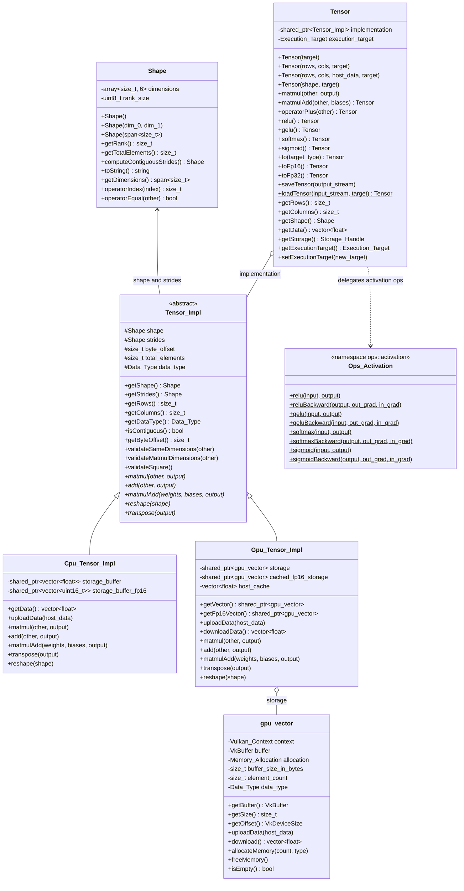

### 2.2. Cơ chế Thiết kế PIMPL & Zero-Copy View

1. **Mẫu thiết kế PIMPL (Pointer to Implementation)**:
   - Lớp công khai [`Tensor`](file:///d:/Not%20Python%20Projects/llm%20-%20Copy/include/math/tensor.h) giữ một con trỏ thông minh `std::shared_ptr<Tensor_Impl>`. Điều này cô lập hoàn toàn các thư viện header nặng (như `<vulkan/vulkan.h>`, SIMD AVX headers) khỏi giao diện người dùng, giúp giảm thời gian biên dịch và đảm bảo ABI ổn định.
   - Việc sao chép nông (shallow copy) của `Tensor` có chi phí $O(1)$, cho phép truyền tensor qua các hàm bằng giá trị mà không nhân bản dữ liệu bộ nhớ đệm (buffer cloning).

2. **Cấu trúc Dữ liệu `Shape` & `Strides`**:
   - `Shape` được tối ưu hóa với mảng tĩnh `std::array<size_t, 6>` và một biến `uint8_t rank_size`. Thiết kế này tránh mọi phép cấp phát bộ nhớ động (`malloc`/`new`) trên Heap khi truy vấn kích thước tensor.
   - Bố cục bộ nhớ lưu trữ theo chuẩn **Row-Major** (C-contiguous). Với tensor có kích thước $(d_0, d_1, \dots, d_{k-1})$, bước nhảy liên tục (contiguous stride) được tính theo công thức đệ quy ngược:
     $$S_{k-1} = 1, \quad S_{i} = S_{i+1} \times d_{i+1} \quad (0 \le i < k-1)$$
   - Vị trí tuyến tính của phần tử tại chỉ số $(i_0, i_1, \dots, i_{k-1})$ trong bộ nhớ:
     $$\text{Linear\_Index} = \text{byte\_offset} + \sum_{j=0}^{k-1} i_j \times S_j$$
   - Khi thực hiện các thao tác cắt lát (slice) hoặc tái định hình (reshape) không làm thay đổi tính liên tục của dữ liệu, `Tensor` chia sẻ cùng một vùng nhớ `gpu_vector` hoặc CPU buffer, chỉ tạo ra một `Tensor_Impl` mới với `strides` và `byte_offset` khác nhau (**Zero-Copy Views**).

3. **Bố cục Bộ nhớ Hỗn hợp FP16 & FP32 (Mixed Precision Storage)**:
   - Trong quá trình tính toán hỗn hợp (AMP - Automatic Mixed Precision), `Gpu_Tensor_Impl` duy trì bộ nhớ chính ở định dạng FP32 (`storage`) và một bộ đệm phụ trợ FP16 được tạo lười (lazy allocation) qua `cached_fp16_storage`.
   - Các phép tính toán tử GEMM (General Matrix Multiply) trên GPU sẽ tự động kích hoạt đường ống FP16 Cooperative Matrix nếu phần cứng hỗ trợ, trong khi các phép chuẩn hóa (RMSNorm, Softmax) vẫn duy trì FP32 để đảm bảo độ ổn định số học (numerical stability).

---

## 3. Hệ thống Lớp Nơ-ron (Concrete Neural Layers)

### 3.1. Sơ đồ Lớp — Layer System (Class Diagram)

```mermaid
classDiagram
    class ILayer {
        <<abstract>>
        #bool is_accumulated
        #bool is_mixed_precision_enabled
        +forward(input_tensor) Tensor
        +backward(output_gradient)* Tensor
        +clone()* unique_ptr~ILayer~
        +saveConfiguration(output_stream)*
        +saveInference(output_stream)*
        +loadInference(input_stream)*
        +saveCheckpoint(output_stream)*
        +loadCheckpoint(input_stream)*
        +getLayerType()* Layer_Type
        +getExecutionTarget()* Execution_Target
        +setExecutionTarget(target)*
        +hasParameters() bool
        +getParametersAndGradients() vector~pair~
        +setMixedPrecision(enable)
        +setAccumulated(is_accumulated)
        +logBufferAddress(tensor, name)
    }

    class Linear_Layer {
        -Tensor weights
        -Tensor biases
        -Tensor weights_gradient_tensor
        -Tensor biases_gradient_tensor
        -Tensor input_tensor
        +forward(input_tensor) Tensor
        +backward(output_gradient) Tensor
        +saveInference(output_stream)
        +loadInference(input_stream)
        +getLayerType() Layer_Type
    }

    class Conv2d_Layer {
        -Tensor weights
        -Tensor biases
        -Tensor weights_gradient_tensor
        -Tensor biases_gradient_tensor
        -Tensor input_tensor
        -uint32_t kernel_size
        -uint32_t stride
        -uint32_t padding
        +forward(input_tensor) Tensor
        +backward(output_gradient) Tensor
    }

    class Transformer_Block {
        -size_t hidden_dim
        -size_t num_heads
        -size_t head_dim
        -RMSNorm_Layer input_layernorm
        -Linear_Layer q_proj
        -Linear_Layer k_proj
        -Linear_Layer v_proj
        -Linear_Layer o_proj
        -RMSNorm_Layer post_attention_layernorm
        -Linear_Layer gate_proj
        -Linear_Layer up_proj
        -Linear_Layer down_proj
        -SwiGLU_Layer swiglu
        +forward(input_tensor) Tensor
        +forward(input_tensor, kv_cache) Tensor
        +backward(output_gradient) Tensor
    }

    class RMSNorm_Layer {
        -Tensor gamma
        -Tensor gamma_gradient_tensor
        -Tensor inv_rms
        -float epsilon
        +forward(input_tensor) Tensor
        +backward(output_gradient) Tensor
    }

    class SwiGLU_Layer {
        -Tensor tensor_a
        -Tensor tensor_b
        -Tensor grad_a
        -Tensor grad_b
        +forward(input_tensor) Tensor
        +forward(a, b) Tensor
        +backward(output_gradient) Tensor
    }

    class Embedding_Layer {
        -Tensor weight
        -Tensor weight_gradient
        -Tensor last_indices_tensor
        +forward(indices_tensor) Tensor
        +backward(output_gradient) Tensor
    }

    class Batch_Norm_Layer {
        -Tensor gamma
        -Tensor beta
        -Tensor running_mean
        -Tensor running_variance
        +forward(input_tensor) Tensor
        +backward(output_gradient) Tensor
    }

    class Res_Net_Block_2d_Layer {
        -vector~ILayer*~ main_branch
        -vector~ILayer*~ shortcut_branch
        -unique_ptr~ILayer~ post_activation
        +addMainLayer(args)
        +addShortcutLayer(args)
        +forward(input_tensor) Tensor
        +backward(output_gradient) Tensor
    }

    class Relu_Layer {
        -Tensor input_tensor
        -Tensor output_tensor
        -Tensor input_gradient_tensor
        -bool is_forward_completed
        +forward(input_tensor) Tensor
        +backward(output_gradient) Tensor
        +clone() unique_ptr~ILayer~
    }

    class Gelu_Layer {
        -Tensor input_tensor
        -Tensor output_tensor
        -Tensor input_gradient_tensor
        -bool is_forward_completed
        +forward(input_tensor) Tensor
        +backward(output_gradient) Tensor
        +clone() unique_ptr~ILayer~
    }

    class Softmax_Layer {
        -Tensor input_tensor
        -Tensor output_tensor
        -Tensor input_gradient_tensor
        -Tensor input_fp32
        -bool is_fused_with_loss
        -bool is_forward_completed
        +forward(input_tensor) Tensor
        +backward(output_gradient) Tensor
        +clone() unique_ptr~ILayer~
    }

    class Sigmoid_Layer {
        -Tensor input_tensor
        -Tensor output_tensor
        -Tensor input_gradient_tensor
        -bool is_forward_completed
        +forward(input_tensor) Tensor
        +backward(output_gradient) Tensor
        +clone() unique_ptr~ILayer~
    }

    class Dropout_Layer {
        -float dropout_rate
        -bool is_training
        -uint64_t seed
        -Tensor mask_tensor
        -Tensor input_tensor
        -Tensor output_tensor
        -Tensor input_gradient_tensor
        -bool is_forward_completed
        +forward(input_tensor) Tensor
        +backward(output_gradient) Tensor
        +clone() unique_ptr~ILayer~
        +setTrainingMode(is_training)
        +getDropoutRate() float
    }

    ILayer <|-- Linear_Layer
    ILayer <|-- Conv2d_Layer
    ILayer <|-- Transformer_Block
    ILayer <|-- RMSNorm_Layer
    ILayer <|-- SwiGLU_Layer
    ILayer <|-- Embedding_Layer
    ILayer <|-- Batch_Norm_Layer
    ILayer <|-- Res_Net_Block_2d_Layer
    ILayer <|-- Relu_Layer
    ILayer <|-- Gelu_Layer
    ILayer <|-- Softmax_Layer
    ILayer <|-- Sigmoid_Layer
    ILayer <|-- Dropout_Layer
    ILayer <|-- Max_Pool_2d_Layer
    ILayer <|-- Batch_Norm_2d_Layer
    ILayer <|-- PPO_Actor_Critic_Layer
    Transformer_Block o-- RMSNorm_Layer : input and post norm
    Transformer_Block o-- SwiGLU_Layer : swiglu activation
    Transformer_Block o-- Linear_Layer : projection layers
    Res_Net_Block_2d_Layer o-- ILayer : main and shortcut branches
```

### 3.2. Cơ chế Hoạt động & Hợp đồng Lớp (ILayer Contract)

1. **Hợp đồng Trừu tượng (Abstract Interface Invariant)**:
   - Mọi lớp mạng đều kế thừa từ [`ILayer`](file:///d:/Not%20Python%20Projects/llm%20-%20Copy/include/layer/ilayer.h) và bắt buộc phải hiện thực hóa hàm `forward()` và `backward()`.
   - `forward(const Tensor &input)`: Nhận tensor đầu vào, lưu lại các trạng thái kích hoạt cần thiết cho lan truyền ngược (như đầu vào, kết quả trung gian) và trả về tensor kết quả.
   - `backward(const Tensor &output_gradient)`: Nhận gradient từ tầng kế tiếp ($\frac{\partial L}{\partial Y}$), tính toán gradient đối với tham số của tầng ($\frac{\partial L}{\partial W}, \frac{\partial L}{\partial B}$) và trả về gradient đối với đầu vào ($\frac{\partial L}{\partial X}$).
   - `getParametersAndGradients()`: Trả về một mảng các cặp tham chiếu `std::vector<std::pair<Tensor*, Tensor*>>` để bộ tối ưu hóa (`IOptimizer`) cập nhật trọng số trực tiếp.
   - *Bảo toàn kiến trúc*: Dòng 66 trong `include/layer/ilayer.h` chứa lệnh `return;` bảo vệ việc hủy tài nguyên an toàn luôn được duy trì bất biến.

2. **Cơ chế Tích lũy Gradient (`is_accumulated`)**:
   - Khi kích hoạt chế độ tích lũy gradient (Gradient Accumulation) để mở rộng kích thước batch hiệu dụng mà không làm tràn bộ nhớ VRAM, cờ `is_accumulated` được bật. Các lớp có trọng số (`Linear_Layer`, `Conv2d_Layer`) sẽ không xóa hoặc ghi đè gradient của bước trước mà thực hiện cộng dồn:
     $$\nabla W_{accum} \mathrel{+}= \nabla W_{step}$$

---

## 4. Hệ thống Toán tử Độc lập (Decoupled Operator Subsystem — `ops::*`)

Quyết định kiến trúc quan trọng nhất trong việc tái cấu trúc hệ thống là **tách rời hoàn toàn các toán tử toán học khỏi `Tensor_Impl`**. Trước đây, `Tensor_Impl` đóng vai trò một "God Class" chứa hàng chục phương thức ảo thuần túy. Việc chuyển đổi sang mô hình **Decoupled Functional Operators** trong namespace `ops::*` đem lại các lợi ích cốt lõi:
- **Nguyên lý Đơn trách nhiệm (Single Responsibility Principle)**: `Tensor_Impl` chỉ quản lý tài nguyên bộ đệm và siêu dữ liệu (Shape, Strides, Alignment). Các thuật toán tính toán thuộc về các đơn vị hàm độc lập.
- **Dễ dàng Mở rộng & Tối ưu hóa**: Mỗi toán tử có thể có các cài đặt riêng biệt cho CPU (SIMD AVX-512/AVX2) và GPU (Vulkan Compute Shader) mà không làm ô nhiễm giao diện của Tensor.
- **Thân thiện với JIT Fusion**: Các toán tử độc lập cho phép `Graph_Optimizer` phân tích metadata của từng kernel và ghép mã GLSL trực tiếp.

### 4.1. Bảng Đặc tả Toán tử Hệ thống (Operator Specifications)

| Namespace | Tên Toán tử | Đầu vào chính | Đầu ra / Gradient | Công thức Toán học | Phương thức GPU / Vulkan |
| :--- | :--- | :--- | :--- | :--- | :--- |
| `ops::activation` | `relu`, `reluBackward` | $X$, $dY$ | $Y$, $dX$ | $Y = \max(0, X)$, $dX = dY \cdot \mathbb{I}(X > 0)$ | Elementwise Compute Workgroup (256, 1, 1) |
| `ops::activation` | `gelu`, `geluBackward` | $X$, $dY$ | $Y$, $dX$ | $Y = 0.5X(1 + \tanh(\sqrt{2/\pi}(X + 0.044715X^3)))$ | Elementwise Compute Shader |
| `ops::activation` | `softmax`, `softmaxBackward` | $X$, $dY$ | $Y$, $dX$ | $Y_i = \frac{e^{X_i - \max(X)}}{\sum e^{X_j}}$, $dX = Y \odot (dY - \sum dY \cdot Y)$ | Shared Memory Parallel Reduction (Max & Sum) |
| `ops::activation` | `sigmoid`, `sigmoidBackward` | $X$, $dY$ | $Y$, $dX$ | $Y = \frac{1}{1 + e^{-X}}$, $dX = dY \cdot Y \cdot (1 - Y)$ | Elementwise Compute Shader |
| `ops::dropout` | `dropout`, `dropoutBackward` | $X, M, dY, p$ | $Y, M, dX$ | $Y = X \odot \frac{M}{1 - p}\ (\text{train}),\ Y = X\ (\text{eval});\ dX = dY \odot \frac{M}{1 - p}$ | CPU Bernoulli PRNG + GPU Hadamard Mul |
| `ops::linear` | `linearForward` | $X, W, B$ | $Y$ | $Y = XW^T + B$ | Tiled Matmul / Cooperative Matrix FP16 |
| `ops::linear` | `linearBackwardInput` | $dY, W$ | $dX$ | $dX = dY \cdot W$ | Transposed Matmul |
| `ops::linear` | `linearBackwardWeightBias` | $X, dY$ | $dW, dB$ | $dW = X^T \cdot dY$, $dB = \sum_{row} dY$ | Batched Outer-product + Reduction |
| `ops::loss` | `mse`, `mae`, `bce`, `cce`, `huber` | $\hat{Y}, Y$ | Loss, $d\hat{Y}$ | Sai số bình phương, tuyệt đối, cross-entropy, mượt | Reduction Kernel + Elementwise Grad |
| `ops::loss` | `fusedCrossEntropy` | $Z, Y_{targets}$ | Loss, $dZ$ | $L = -\log \text{softmax}(Z)_{target}$, $dZ = P - Y_{onehot}$ | Fused Log-Sum-Exp Reduction Kernel |
| `ops::vision` | `conv2d`, `conv2dBackward` | $X, W, B, dY$ | $Y, dX, dW, dB$ | Im2Col + GEMM Convolution | Scratch Buffer Reuse + Parallel GEMM |
| `ops::vision` | `maxpool2d`, `maxpool2dBackward` | $X, dY$ | $Y, Mask, dX$ | Max pooling trên cửa sổ $K \times K$ có stride | Argmax Mask Buffer Indexing |
| `ops::vision` | `globalAvgPool2d` | $X, dY$ | $Y, dX$ | $Y = \frac{1}{HW} \sum_{h,w} X_{c,h,w}$ | Channel-wise Spatial Reduction |
| `ops::normalization` | `rmsnorm` | $X, \gamma$ | $Y, \text{inv\_rms}$ | $Y = \frac{X}{\sqrt{\frac{1}{d}\sum X_i^2 + \epsilon}} \odot \gamma$ | Two-pass Shared Memory Reduction |
| `ops::normalization` | `batchNorm`, `batchNorm2d` | $X, \gamma, \beta$ | $Y, \mu, \sigma^2$ | $Y = \frac{X - \mu}{\sqrt{\sigma^2 + \epsilon}} \gamma + \beta$ | Moving Average + Spatial Reduction |
| `ops::optimizer` | `adamStep` | $W, G, M, V$ | $W, M, V$ | $m_t = \beta_1 m + (1-\beta_1)g, v_t = \beta_2 v + (1-\beta_2)g^2$ | Fused Elementwise AdamW Kernel |
| `ops::optimizer` | `sgdStep` | $W, G, V$ | $W, V$ | $v_t = \mu v + g, W = W - \eta v_t$ | Elementwise Momentum Kernel |
| `ops::llm` | `flashAttentionForward` | $Q, K, V$ | $O, L_{stats}$ | Tiled FlashAttention (Tri Dao algorithm) | Online Softmax Tile Tensors in LDS |
| `ops::llm` | `singleTokenAttentionForward` | $q_{curr}, K_{cache}, V_{cache}$ | $o_{curr}$ | Tối ưu hóa suy luận tuần tự 1 token | Causal KV Cache Circular Read |
| `ops::llm` | `applyRoPE` | $X, \text{pos}$ | $Y$ | Rotary Position Embedding trên từng cặp vector | Complex Multiplication GLSL Shader |
| `ops::llm` | `swigluForward` | $A, B$ | $Y$ | $Y = (A \cdot \sigma(A)) \odot B$ | Fused Swish-Gate Kernel |
| `ops::llm` | `embeddingLookup` | $W, \text{Indices}$ | $Y$ | $Y[i] = W[\text{Indices}[i]]$ | Direct Index Gathering SSBO |

### 4.2. Cơ chế Tối ưu hóa Fused Operators & DynamicParams

1. **Toán tử Mất mát Hợp nhất (`ops::loss::fusedCrossEntropy`)**:
   - Thay vì thực hiện 2 kernel riêng biệt: (1) Tính $\text{Softmax}(Z)$, ghi ra bộ nhớ VRAM, rồi (2) Tính $\text{CrossEntropyLoss}$ và gradient, hàm `fusedCrossEntropy` gộp toàn bộ quá trình vào một kernel duy nhất.
   - Giải thuật tính $\text{LogSumExp}$ trực tiếp trên thanh ghi nội bộ (Registers) bằng kỹ thuật ổn định số học:
     $$m = \max_j Z_j, \quad l = \sum_j e^{Z_j - m}, \quad \log \left(\sum e^{Z_j}\right) = m + \log(l)$$
   - Gradient đối với logits được tính phân tích trực tiếp:
     $$\frac{\partial L}{\partial Z_i} = P_i - \mathbb{I}(i = \text{target})$$
   - Điều này triệt tiêu hoàn toàn một lượt đọc/ghi bộ nhớ toàn cục (Global VRAM round-trip), tăng tốc độ tính toán lên hơn 2.5x và hỗ trợ trực tiếp nhãn mục tiêu thưa (`int32_t indices`) với cơ chế bỏ qua token đệm (`ignore_index`).

2. **Cơ chế Nạp Tham số Động (`DynamicParams` trong `ops::optimizer`)**:
   - Khi cập nhật hàng trăm ma trận trọng số trong mô hình lớn, việc gọi `vkCmdDispatch` cho từng tensor sẽ gây ra chi phí lập lịch CPU quá mức (driver overhead).
   - Hệ thống hỗ trợ cơ chế gom các con trỏ bộ đệm (weights, gradients, first moments, second moments) vào một descriptor SSBO duy nhất (`binding = 2`). Kernel Vulkan duyệt qua mảng thông số và cập nhật hàng loạt tensor trong một lượt dispatch duy nhất, kết hợp kiểm tra độ trôi gradient (Gradient Clipping) và khôi phục tỷ lệ mất mát FP16 (Loss Unscaling).

---

## 5. Đồ thị Tính toán & Tối ưu hóa JIT (Execution Engine & Graph Optimization)

### 5.1. Sơ đồ Lớp — Engine & Optimizer (Class Diagram)

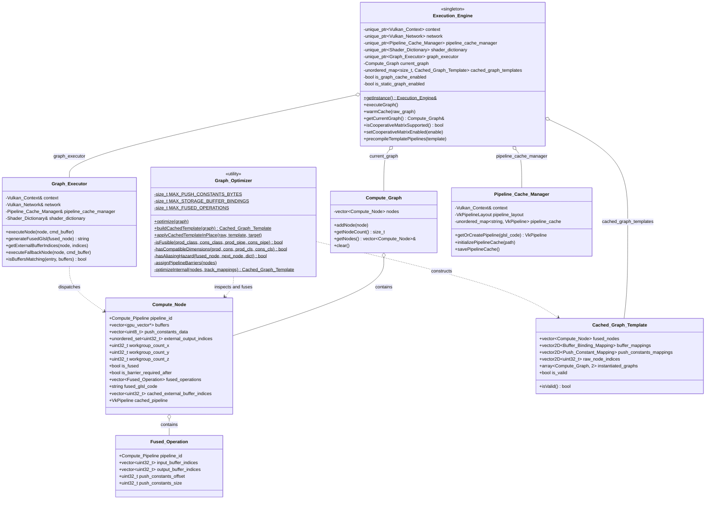

### 5.2. Giải thuật JIT Operator Fusion & Quản lý Xung đột Bộ nhớ (Hazard Analysis)

Quá trình tối ưu hóa đồ thị tính toán diễn ra tự động trước khi dispatch các lệnh xuống GPU:

1. **Điều kiện Hợp nhất Toán tử (`Graph_Optimizer::isFusible`)**:
   Hai node kế tiếp (Producer và Consumer) chỉ được phép ghép (fuse) khi thỏa mãn toàn bộ các điều kiện:
   - Consumer phải thuộc phân lớp `Operation_Class::ELEMENTWISE` (ví dụ: ReLU, GELU, Sigmoid, Add, BiasAdd, Scale).
   - Consumer không được sử dụng Cooperative Matrix (do ràng buộc kích thước ma trận con 16x16x16).
   - Tổng số thao tác ghép không vượt quá giới hạn phần cứng:
     - `MAX_STORAGE_BUFFER_BINDINGS = 32` (giới hạn số lượng SSBO binding trong một Descriptor Set).
     - `MAX_PUSH_CONSTANTS_BYTES = 128` (giới hạn kích thước Push Constants đảm bảo tương thích 100% card đồ họa Vulkan).
     - `MAX_FUSED_OPERATIONS = 8` (tránh shader quá phức tạp gây suy giảm số lượng thanh ghi khả dụng trên mỗi Compute Unit).

2. **Phân tích Xung đột Đọc/Ghi (Aliasing & Hazard Analysis)**:
   - Hàm `hasAliasingHazard` sử dụng metadata từ `Shader_Dictionary` để xác định chính xác danh sách các buffer đang được Đọc (Read) và Ghi (Write).
   - **Xung đột RAW (Read-After-Write)** hoặc **WAR (Write-After-Read)**: Nếu một buffer vừa là đầu ra của phép tính trước nhưng lại được đọc đồng thời bởi một luồng khác mà không có đồng bộ hóa nội bộ workgroup (`subgroupBarrier` hoặc `barrier()`), thuật toán sẽ từ chối fuse và bắt buộc tạo một node tính toán độc lập kèm theo một `VkMemoryBarrier`.

3. **Cơ chế Tái sử dụng Đồ thị Không chi phí (Zero-Overhead Replay qua `Cached_Graph_Template`)**:
   - Khi mô hình thực hiện huấn luyện qua hàng ngàn epoch, cấu trúc đồ thị tính toán không thay đổi (chỉ có con trỏ dữ liệu hoặc push constant thay đổi theo batch).
   - Khi chạy bước đầu tiên (Warmup/Cache Miss), `Graph_Optimizer::buildCachedTemplate` phân tích cấu trúc, sinh mã GLSL hợp nhất, biên dịch SPIR-V và xây dựng bảng ánh xạ:
     - `Buffer_Binding_Mapping`: Ánh xạ từ chỉ số buffer của node thô sang chỉ số buffer của node hợp nhất.
     - `Push_Constant_Mapping`: Ánh xạ offset và size của push constant trong node hợp nhất.
   - Ở các bước tiếp theo (Cache Hit), `applyCachedTemplateInPlace` chỉ mất dưới **5 microsecond** trên CPU để sao chép con trỏ bộ đệm vào đồ thị đã phân bổ sẵn, loại bỏ hoàn toàn chi phí duyệt đồ thị và biên dịch shader!

---

## 6. Tầng Lõi Vulkan Compute Backend & Bộ cấp phát con (Vulkan Core Backend & Sub-Allocator)

### 6.1. Sơ đồ Lớp — Vulkan Core Backend (Class Diagram)

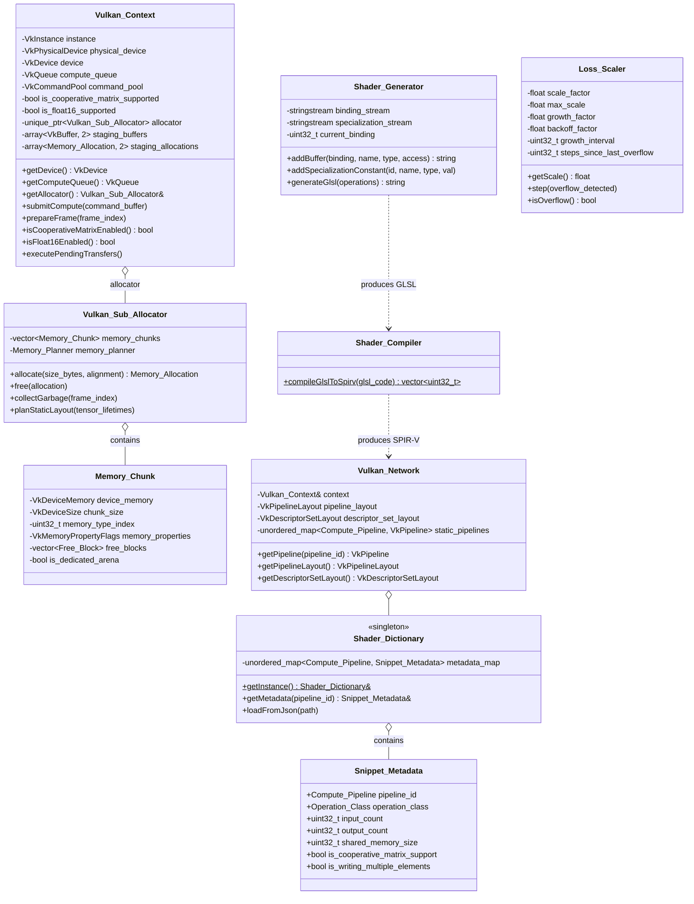

### 6.2. Cơ chế Quản lý Bộ nhớ Sub-Allocation & Tái sử dụng VRAM (Memory Planning)

1. **Vấn đề Giới hạn Cấp phát của Vulkan**:
   - Đặc tả kỹ thuật Vulkan quy định biến `maxMemoryAllocationCount` của phần cứng thường bị giới hạn ở con số **4096** lần gọi `vkAllocateMemory`. Nếu mỗi Tensor cấp phát một `VkDeviceMemory` riêng lẻ, mô hình sẽ nhanh chóng làm cạn kiệt tài nguyên của driver hệ điều hành.
   - Lệnh gọi `vkAllocateMemory` là một thao tác rất nặng (thường liên quan đến kernel transition trong OS driver).

2. **Kiến trúc `Vulkan_Sub_Allocator`**:
   - Cấp phát các khối bộ nhớ lớn (`Memory_Chunk`) với kích thước tiêu chuẩn **64MB, 128MB hoặc 256MB** từ vùng nhớ tối ưu nhất (`VK_MEMORY_PROPERTY_DEVICE_LOCAL_BIT`).
   - Khi một `gpu_vector` yêu cầu bộ nhớ, bộ cấp phát tìm kiếm trong danh sách các khối trống (`Free_Block`) bằng thuật toán **Best-Fit Alignment** (đảm bảo căn chỉnh lề địa chỉ tối thiểu 4 bytes cho float và 16/32 bytes cho Cooperative Matrix).
   - Khi tensor bị hủy, khối nhớ được trả về danh sách `free_blocks` và tự động thực hiện gom cụm (Coalescing) các khối liền kề để chống phân mảnh bộ nhớ (anti-fragmentation).

3. **Thuật toán Hoạch định Bộ nhớ Tĩnh (`Memory_Planner`)**:
   - Đối với đồ thị tĩnh trong quá trình Inference hoặc Training, `Memory_Planner` phân tích khoảng thời gian tồn tại của từng tensor (`Tensor_Lifetime`: xác định bởi `start_node_index` và `end_node_index`).
   - Hai tensor không có sự chồng lấn về thời gian sống (ví dụ: các biến kích hoạt trung gian ở các tầng khác nhau) sẽ được bố trí vào **cùng một offset bộ nhớ VRAM** (Safe Memory Aliasing).
   - Cơ chế này giúp giảm lượng VRAM tiêu thụ thực tế của toàn bộ mạng sâu (Deep Neural Network) lên đến **60% - 75%** so với cấp phát độc lập.

4. **Đồng bộ hóa Hai Khung đệm (Double-Buffered Frames in Flight)**:
   - Hệ thống duy trì `MAX_FRAMES_IN_FLIGHT = 2`.
   - Trong khi GPU đang bận thực thi các lệnh dispatch của Khung hình $N$, CPU có thể chuẩn bị dữ liệu và ghi trước các lệnh của Khung hình $N+1$ vào command buffer độc lập. Việc chuyển giao giữa hai khung hình được đồng bộ thông qua `VkFence` và các `VkEvent` nhẹ.

---

## 7. Mô hình Huấn luyện & Quản lý Trạng thái (Neural Network & Training Context)

### 7.1. Sơ đồ Lớp — Training Subsystem (Class Diagram)

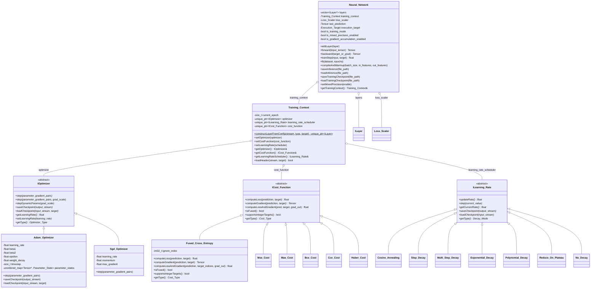

### 7.2. Chu trình Huấn luyện & Điều chỉnh Tỷ lệ Tổn thất Động (Dynamic Loss Scaler)

Chu trình huấn luyện hoàn chỉnh một bước (`trainStep`) diễn ra theo thứ tự nghiêm ngặt:
1. **Lan truyền xuôi (Forward Pass)**:
   Tensor đầu vào lần lượt đi qua danh sách các lớp trong `layers`. Kết quả dự đoán được lưu tại `last_prediction`.
2. **Tính toán Mất mát & Khởi tạo Gradient (Loss Computation)**:
   Nếu sử dụng hàm mất mát tích hợp (`isFused() == true`), `Fused_Cross_Entropy` tính loss đồng thời sinh ra tensor gradient đầu vào tầng cuối cùng.
3. **Lan truyền ngược (Backward Pass)**:
   Gradient được nhân với hệ số `scale_factor` của `Loss_Scaler` (nếu đang ở chế độ FP16 AMP) nhằm ngăn hiện tượng tràn số dưới (Underflow) do khoảng giá trị hữu hạn của FP16 ($2^{-24} \approx 5.96 \times 10^{-8}$).
   Gradient lần lượt truyền ngược qua các lớp từ $N-1$ về $0$.
4. **Kiểm tra Tràn số (Overflow Detection) & Bước Tối ưu hóa**:
   - Nếu phát hiện bất kỳ giá trị nào là `NaN` hoặc `Inf` trong gradient: Bước cập nhật bị bỏ qua (Skip Step), `Loss_Scaler` giảm tỷ lệ (`scale_factor *= backoff_factor`, thường là $0.5$).
   - Nếu gradient hoàn toàn hợp lệ trong liên tiếp `growth_interval` bước (ví dụ: 2000 bước): `scale_factor` được tăng gấp đôi (`scale_factor *= growth_factor`).
   - `IOptimizer::step` thực hiện cập nhật trọng số sau khi chia ngược hệ số tỉ lệ (`inv_scale = 1.0f / scale_factor`).
5. **Cập nhật Lịch trình Tốc độ học (Scheduler Step)**:
   `ILearning_Rate` điều chỉnh tốc độ học $\eta$ theo các chiến lược như Cosine Annealing, Step Decay hoặc Plateau.

---

## 8. Phân hệ Mô hình Ngôn ngữ Lớn (LLM & Tokenizer Subsystem)

### 8.1. Sơ đồ Lớp — LLM Subsystem (Class Diagram)

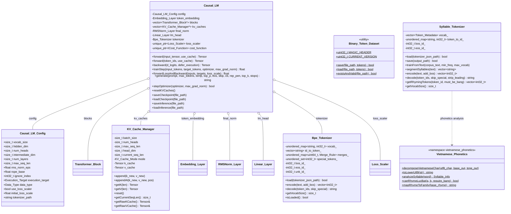

### 8.2. Cơ chế Suy luận Tự hồi quy & KV Cache Tuần hoàn

1. **Kiến trúc Transformer Decoder-Only Hiện đại**:
   - Kiến trúc của `Causal_LM` tuân theo chuẩn các mô hình ngôn ngữ mã nguồn mở hàng đầu (như LLaMA, Mistral, Gemma):
     - **Pre-RMSNorm**: Chuẩn hóa đầu vào trước mỗi khối chú ý và FFN, giúp gradient truyền ổn định ở các mạng có độ sâu lớn.
     - **RoPE (Rotary Position Embedding)**: Mã hóa vị trí tương đối thông qua phép quay ma trận trong không gian phức, giúp mô hình suy luận tốt vượt chiều dài ngữ cảnh huấn luyện.
     - **SwiGLU FFN**: Sử dụng cổng kích hoạt nhân Swish ($x \cdot \text{sigmoid}(x)$) kết hợp với 3 ma trận chiếu (`gate_proj`, `up_proj`, `down_proj`).
     - **FlashAttention**: Tối ưu hóa bộ nhớ chú ý xuống $O(N)$ bằng kỹ thuật chia khối (tiling).

2. **Cơ chế KV Cache Tuần hoàn (`KV_Cache_Manager`)**:
   - Trong quá trình sinh văn bản từng token (token-by-token generation), tính toán lại toàn bộ ma trận $K$ và $V$ của các token quá khứ là thao tác cực kỳ lãng phí $O(N^2)$.
   - `KV_Cache_Manager` phân bổ trước một vùng đệm cố định trên VRAM có kích thước `(Batch, MaxSeqLen, NumHeads, HeadDim)`.
   - Mỗi bước sinh token mới, chỉ duy nhất vector $Q$ của token hiện tại được tính toán. Vector $K_{new}$ và $V_{new}$ được ghi vào vị trí `current_seq_len` thông qua phương thức `append()`.
   - Toán tử `ops::llm::singleTokenAttentionForward` chỉ đọc các lát cắt bộ nhớ hợp lệ từ 0 đến `current_seq_len`, giảm độ phức tạp tính toán từ $O(N^2)$ xuống $O(N)$ cho mỗi token sinh ra.

3. **Thuật toán Chọn mẫu Đa dạng (Sampling Pipeline)**:
   Bộ giải mã của `Causal_LM` hỗ trợ chuỗi các kỹ thuật tinh chỉnh xác suất:
   - **Repetition Penalty**: Giảm xác suất các token đã xuất hiện gần đây trong cửa sổ ngữ cảnh:
     $$Z_i = \begin{cases} Z_i / \text{penalty} & \text{nếu } Z_i > 0 \\ Z_i \times \text{penalty} & \text{nếu } Z_i \le 0 \end{cases}$$
   - **Temperature Scaling**: Điều chỉnh độ sắc nét của phân phối xác suất ($Z_i \leftarrow Z_i / T$).
   - **Top-K Truncation**: Chỉ giữ lại $K$ token có logit cao nhất.
   - **Top-P (Nucleus) Sampling**: Chọn tập hợp token nhỏ nhất có tổng xác suất tích lũy đạt ngưỡng $P$ (ví dụ: $0.9$), sau đó tái chuẩn hóa phân phối và lấy mẫu ngẫu nhiên.

---

## 9. Phân hệ Tiến hóa Nơ-ron Quần thể (Population & Neuroevolution)

### 9.1. Sơ đồ Lớp — Population System (Class Diagram)

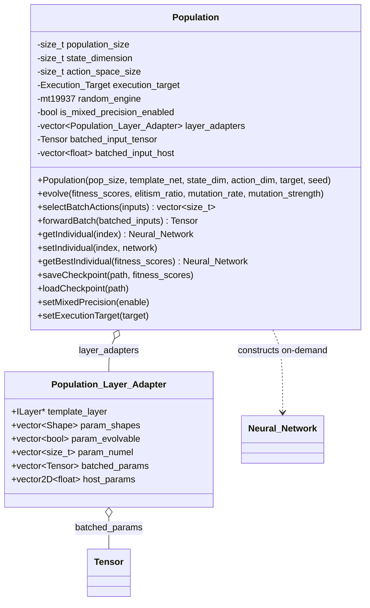

### 9.2. Cơ chế Batched GPU GEMM cho Quần thể (Structure of Arrays)

1. **Khái niệm & Điểm nghẽn Cổ điển**:
   - Trong các thuật toán tiến hóa nơ-ron truyền thống (Genetic Algorithms, Neuroevolution of Augmenting Topologies), mỗi cá thể thường là một đối tượng `Neural_Network` riêng rẽ (Array of Structures - AoS). Khi quần thể có kích thước lớn ($P = 1000$), việc chạy suy luận cho từng cá thể tuần tự trên CPU/GPU gây ra độ trễ điều phối nghiêm trọng và không tận dụng được sức mạnh tính toán song song của GPU.

2. **Thiết kế Cấu trúc Mảng (Structure of Arrays - SoA)**:
   - VulkanML tổ chức toàn bộ quần thể dưới dạng các khối tensor gộp (Batched Tensors).
   - Với một tầng tuyến tính có kích thước $(D_{in}, D_{out})$, thay vì lưu $P$ ma trận độc lập, lớp `Population_Layer_Adapter` gộp toàn bộ trọng số của $P$ cá thể thành một Tensor 3 chiều duy nhất có kích thước:
     $$\text{Batched\_Weights} \in \mathbb{R}^{P \times D_{in} \times D_{out}}$$
   - Đầu vào từ môi trường của $P$ cá thể cũng được gộp thành:
     $$\text{Batched\_Input} \in \mathbb{R}^{P \times 1 \times D_{in}}$$
   - Phép tính lan truyền xuôi cho toàn bộ quần thể được thực thi bằng **một lệnh gọi duy nhất (Single Batched GEMM)** trên GPU:
     $$\text{Batched\_Output} = \text{Batched\_Input} \boxtimes \text{Batched\_Weights} + \text{Batched\_Biases}$$
   - Điều này giúp tốc độ đánh giá độ thích nghi (Fitness Evaluation) tăng tốc từ **50x đến 120x**, cho phép mô phỏng hàng triệu bước tiến hóa trong thời gian thực.

3. **Cơ chế Đột biến & Tinh hoa (Elitism & Mutation)**:
   - Sau khi nhận điểm thích nghi (`fitness_scores`), thuật toán chọn ra top cá thể ưu tú nhất dựa trên tỷ lệ `elitism_ratio` để bảo toàn không thay đổi sang thế hệ sau.
   - Các cá thể còn lại được sinh ra bằng cách áp dụng đột biến Gauss lên các cá thể ưu tú:
     $$W_{child} = W_{elite} + \mathcal{N}(0, \sigma^2)$$
   - Quá trình đột biến được tối ưu hóa trực tiếp trên bộ đệm host hoặc qua compute shader mà không cần tái cấp phát bộ nhớ.

---

## 10. Luồng Tuần tự — Ghép Toán tử JIT Đồ thị (Sequence: JIT Fusion Pipeline)

### 10.1. Sơ đồ Tuần tự Ghép Toán tử (Sequence Diagram)

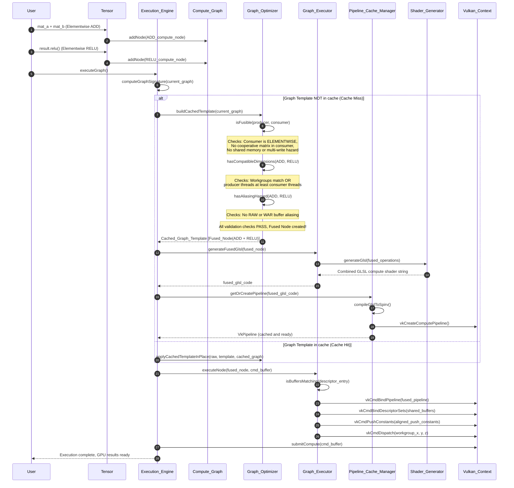

### 10.2. Thuyết minh Chi tiết Các bước Thực thi

1. **Ghi nhận Toán tử (Operator Recording, Bước 1–4)**:
   - Khi mã người dùng gọi các phép toán tử liên tiếp (ví dụ: `result = (a + b).relu()`), lớp `Tensor` không thực thi kernel GPU ngay lập tức. Thay vào đó, nó đóng gói thông tin (buffer handles, push constants, workgroup size) và đẩy các `Compute_Node` tương ứng vào `Compute_Graph`.
2. **Kiểm tra Chữ ký Đồ thị (Signature Hashing, Bước 5–6)**:
   - `Execution_Engine::executeGraph` tính toán mã băm 64-bit dựa trên chuỗi các `pipeline_id` và kích thước ma trận trong đồ thị.
3. **Trường hợp Cache Miss (Tối ưu & Ghép toán tử, Bước 7–19)**:
   - `Graph_Optimizer` quét đồ thị, phát hiện cặp phép toán `ADD` (Producer) và `RELU` (Consumer) có thể ghép được.
   - `Shader_Generator` tạo mã nguồn GLSL động: thay vì `ADD` ghi kết quả vào bộ đệm VRAM và `RELU` đọc lại từ VRAM, kết quả của phép cộng được lưu vào một biến thanh ghi cục bộ (private variable `float temp_acc`) và truyền thẳng qua hàm kích hoạt $\max(0.0, \text{temp\_acc})$.
   - `Shader_Compiler` gọi thư viện nội bộ biên dịch mã GLSL thành nhị phân SPIR-V.
   - `Pipeline_Cache_Manager` gọi `vkCreateComputePipeline` và lưu `VkPipeline` vào bộ nhớ đệm (bộ nhớ trong và tệp nhị phân trên đĩa).
4. **Trường hợp Cache Hit (Ánh xạ bộ đệm tại chỗ, Bước 20–21)**:
   - Bỏ qua toàn bộ khâu tối ưu và biên dịch. `applyCachedTemplateInPlace` chỉ cập nhật lại con trỏ `VkBuffer` và các giá trị trong khối push constants.
5. **Ghi và Phát lệnh GPU (Command Recording & Dispatch, Bước 22–28)**:
   - Ghi lệnh gắn pipeline (`vkCmdBindPipeline`), gắn descriptor set (`vkCmdBindDescriptorSets`), nạp push constants và phát nhóm luồng tính toán (`vkCmdDispatch`).
   - `submitCompute` gửi command buffer tới hàng đợi `compute_queue` của GPU kèm theo tín hiệu Timeline Semaphore/Fence.

---

## 11. Luồng Tuần tự — Quá trình Sinh Token Tự hồi quy (Sequence: LLM Autoregressive Generation)

### 11.1. Sơ đồ Tuần tự Sinh Token (Sequence Diagram)

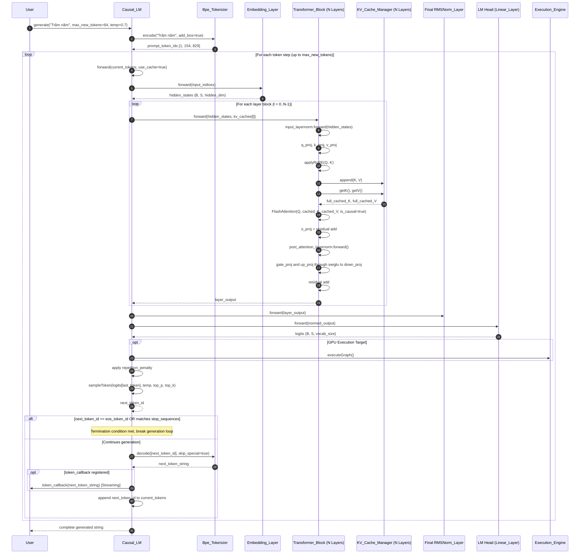

### 11.2. Thuyết minh Chi tiết Quá trình Tự hồi quy

1. **Giai đoạn Tiền xử lý (Tokenization & Prompt Prefill, Bước 1–3)**:
   - Chuỗi văn bản prompt đầu vào được phân tích cú pháp thông qua `Bpe_Tokenizer::encode`, chèn thêm mã bắt đầu chuỗi (`BOS = 1`).
2. **Vòng lặp Sinh Từng Token (Autoregressive Loop, Bước 4–46)**:
   - **Prompt Processing (Prefill Phase)**: Trong bước lặp đầu tiên, toàn bộ chuỗi token của prompt được đưa vào mạng để khởi tạo trạng thái bộ nhớ đệm ban đầu trong `KV_Cache_Manager`.
   - **Decode Phase**: Từ bước thứ 2 trở đi, chỉ **duy nhất 1 token** vừa sinh ra được truyền vào `Causal_LM::forward`.
   - **RoPE Embedding**: Mỗi vector truy vấn $Q$ và khóa $K$ được quay theo tọa độ góc tương ứng với vị trí thời gian hiện tại (`current_seq_len`).
   - **Cập nhật KV Cache**: Vector $K$ và $V$ của token hiện tại được gắn thêm vào bộ đệm tĩnh của tầng mà không cấp phát lại bộ nhớ.
   - **FlashAttention**: Tính toán ma trận chú ý giữa vector $Q$ duy nhất với toàn bộ lịch sử $K, V$ đã lưu trữ.
   - **LM Head & Logits**: Tầng tuyến tính chiếu không gian ẩn về không gian từ điển (`vocab_size`).
3. **Bộ chọn mẫu & Điều kiện Kết thúc (Sampling & Callback, Bước 33–46)**:
   - Logit của token cuối cùng được phạt lặp từ (`repetition_penalty`) và chọn mẫu ngẫu nhiên có kiểm soát (`temperature`, `top_p`, `top_k`).
   - Token sinh ra được giải mã sang chuỗi UTF-8 và gửi ngay lập tức tới người dùng thông qua cơ chế phản hồi theo luồng (`token_callback` streaming).
   - Nếu token trùng với `EOS` (End-of-Sequence) hoặc khớp với danh sách từ dừng (`stop_sequences`), vòng lặp dừng lại.

---

## 12. Đồ thị Trạng thái — Vòng đời Đồ thị Tính toán (State Diagram: Graph Lifecycle)

### 12.1. Sơ đồ Trạng thái (State Diagram)

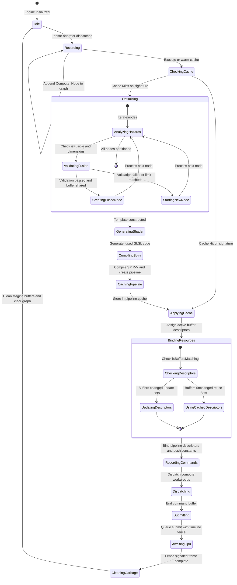

### 12.2. Thuyết minh Các Trạng thái & Điều kiện Chuyển dịch

| Trạng thái | Điều kiện Kích hoạt | Hành vi & Cơ chế Kỹ thuật | Trạng thái Kế tiếp |
| :--- | :--- | :--- | :--- |
| `Idle` | Khởi tạo thành công `Execution_Engine` | Động cơ ở trạng thái chờ. Đồ thị `current_graph` rỗng, không chiếm dụng tài nguyên CPU/GPU. | `Recording` |
| `Recording` | Người dùng hoặc Layer gọi một phép tính toán tử trên `Tensor` | Đóng gói con trỏ `gpu_vector`, dữ liệu push constants, kích thước workgroup và thêm vào danh sách `nodes`. | `Recording` hoặc `CheckingCache` |
| `CheckingCache` | Gọi `executeGraph()` hoặc `warmCache()` | Tính toán chữ ký băm 64-bit của toàn bộ chuỗi node trong đồ thị để kiểm tra sự tồn tại trong `cached_graph_templates`. | `ApplyingCache` (Hit) hoặc `Optimizing` (Miss) |
| `Optimizing` | Chữ ký đồ thị chưa từng xuất hiện (Cache Miss) | Duyệt qua các node, phân tích xung đột dữ liệu (RAW, WAW, WAR), kiểm tra tính tương thích của kích thước phân phối và gom nhóm các node thành `fused_nodes`. | `GeneratingShader` |
| `GeneratingShader` | Quá trình phân nhóm tối ưu hoàn tất | `Shader_Generator` nối các đoạn mã GLSL từ `Shader_Dictionary`, tạo binding SSBO thống nhất và layout push constants mới. | `CompilingSpirv` |
| `CompilingSpirv` | Chuỗi mã nguồn GLSL hợp nhất đã sẵn sàng | Gọi `Shader_Compiler` để biên dịch trực tiếp sang mã nhị phân SPIR-V. | `CachingPipeline` |
| `CachingPipeline` | Nhị phân SPIR-V hợp lệ | Tạo đối tượng `VkPipeline` thông qua Vulkan driver và lưu vào bảng băm `Pipeline_Cache_Manager`. | `ApplyingCache` |
| `ApplyingCache` | Đồ thị đã có template tối ưu hợp lệ | Cập nhật ánh xạ địa chỉ bộ đệm thực tế vào đồ thị đích (`applyCachedTemplateInPlace`) mà không cấp phát lại bộ nhớ. | `BindingResources` |
| `BindingResources` | Đồ thị thực thi đã sẵn sàng | Kiểm tra xem descriptor set hiện tại có trùng khớp với danh sách buffer hay không (`isBuffersMatching`). Tái sử dụng descriptor set nếu không đổi hoặc ghi đè descriptor write nếu buffer thay đổi. | `RecordingCommands` |
| `RecordingCommands`| Tài nguyên đã được gắn kết | Ghi các lệnh `vkCmdBindPipeline`, `vkCmdBindDescriptorSets`, `vkCmdPushConstants` vào command buffer của khung hình hiện tại. | `Dispatching` |
| `Dispatching` | Các trạng thái pipeline đã sẵn sàng | Ghi lệnh `vkCmdDispatch(workgroup_x, y, z)` và chèn các `vkCmdPipelineBarrier` cần thiết giữa các node. | `Submitting` |
| `Submitting` | Hoàn tất ghi command buffer (`vkEndCommandBuffer`) | Gửi command buffer tới `compute_queue` thông qua `vkQueueSubmit` đi kèm một `VkFence` đồng bộ. | `AwaitingGpu` |
| `AwaitingGpu` | Chờ GPU xử lý | CPU có thể tiếp tục công việc trên khung hình thứ hai hoặc gọi `vkWaitForFences` để chờ GPU hoàn tất. | `CleaningGarbage` |
| `CleaningGarbage` | `VkFence` được báo hiệu (Signaled) | Thu hồi các staging buffer trung gian, xóa danh sách node trong `current_graph` và đưa động cơ về trạng thái sẵn sàng. | `Idle` |

---

## 13. Kết luận & Định hướng Tương lai (Summary & Roadmap)

Kiến trúc của **VulkanML** kết hợp hài hòa giữa tính linh hoạt của các framework bậc cao (như PyTorch) với hiệu năng tính toán cực hạn và khả năng kiểm soát phần cứng chi tiết của **C++23** và **Vulkan Compute API**:
1. **Kiến trúc Toán tử Tách rời (`ops::*`)**: Giúp mã nguồn mô-đun hóa cao, loại bỏ sự phụ thuộc chéo và cho phép mở rộng các phép tính chuyên biệt (Vision, LLM, Reinforcement Learning) mà không làm phức tạp hóa tầng trừu tượng `Tensor`.
2. **Bộ tối ưu hóa JIT Đồ thị Không chi phí (`Graph_Optimizer` & Templates)**: Đạt tốc độ thực thi gần như bare-metal trên GPU bằng cách ghép các toán tử liên tiếp, giảm thiểu băng thông đọc/ghi bộ nhớ VRAM và tái sử dụng đồ thị trong vài microsecond.
3. **Quản lý Bộ nhớ Cấp cao (`Vulkan_Sub_Allocator` & `Memory_Planner`)**: Giải quyết triệt để giới hạn cấp phát của Vulkan và tái sử dụng bộ nhớ thông minh qua vòng đời tensor, cho phép huấn luyện và suy luận các mô hình nơ-ron sâu và LLM trên các thiết bị có dung lượng VRAM khiêm tốn.

Các định hướng phát triển tiếp theo bao gồm:
- Mở rộng hỗ trợ chuẩn **VK_KHR_ray_tracing** cho các bài toán đồ họa nơ-ron (NeRF, 3D Gaussian Splatting).
- Tích hợp chuẩn **quantization 4-bit (INT4/AWQ/GPTQ)** trực tiếp trong `ops::llm` để tối ưu hóa bộ nhớ cho các mô hình ngôn ngữ lớn trên GPU phổ thông.
- Hỗ trợ tính toán song song trên nhiều thiết bị GPU (Multi-GPU Compute Dispatch) thông qua Vulkan Device Groups.
